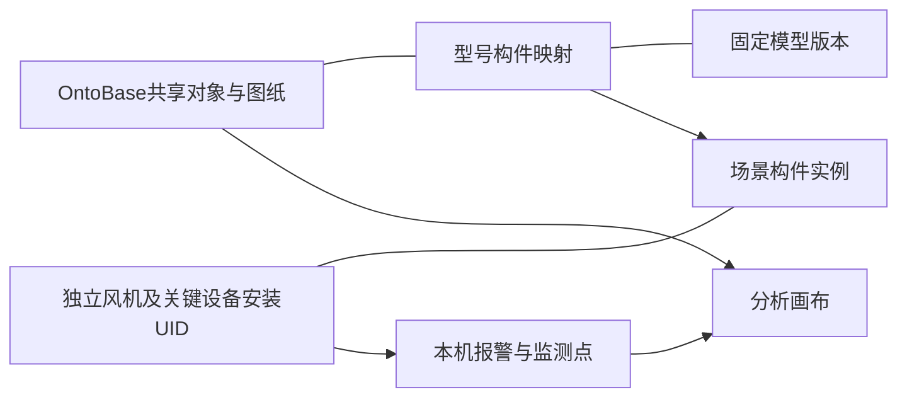

# 模型中心构件绑定与共享工程定义设计

2026-10-27晚间调整：用户要求将项目共享映射配置移至“设备层级”，安装对象归入 OntoBase 设备库。本文保留为此前方案；后续评审采用[设备层级与设备库关系调整方案](设备层级与设备库关系调整方案.md)。其中“模型中心管理项目映射”和安装对象混入工程目录的方式不再作为下一实施目标。新方案已于2026-10-28获用户批准，实施采用设备层级入口；实际结果见执行记录§124。本文其余内容保留历史提案语境。

2026-10-27。用户已确认共享定义方案及柜码。本文件与同一 MagicPath 工作台的构件绑定交互共同构成待评审设计；新的型号映射与场景采用界面尚未作为生产能力上线。当前源系统新增接口和测试建档的实际结果另记于[执行记录§120](../plans/开发执行记录.md#120-场景连续缩放共享工程定义与模型中心绑定设计2026-10-27)。

## 1. 共享资料，独立记录单台身份

15台风机编号为 **1、4—16、18**。保留1133个既有非安装工程对象作为同型号共享来源，原范围、分类和审核状态保持。增加CT柜定义及10类主要设备定义；每台建立独立风机安装身份及13个关键设备安装对象，不逐台复制全部图纸工程对象。

| 数据 | 保存位置与归属 | 15台之间如何使用 |
|---|---|---|
| 工程对象、图纸元素、端口、引用、手册知识节点 | OntoBase共享工程定义/来源对象 | 同型号共用一套已有资料关联 |
| 风机与三柜等关键设备安装身份 | OntoBase演示安装范围 | 每台独立UID，关联共享定义 |
| 模型文件、固定版本、构件键、型号映射 | ONTOVis模型中心 | 同一项目、同一固定模型版本的映射可重复采用 |
| 模型放置位置、整机安装对象、采用的映射版本 | ONTOVis场景 | 每次放置独立实例，明确关联哪台风机 |
| 故障、监测点、检修记录、现场照片 | 当前风机/设备实例 | 按安装身份隔离，再引用共享工程依据 |

图纸里的`=WEC+CN1-1B4`仍关联原共享对象UID；在7号或18号分析它时，同时携带本机安装范围。无需将同一图纸重新识别15遍，也不为15台复制相同图纸区域。

柜码固定为 **CN1机舱动力柜、CN2机舱信号柜、CT塔基信号柜**。共享定义层只有这三种柜体；每台各有三个安装柜，不能把不同机位的同名安装柜当作冗余定义删除。原7号“CN信号柜”补关联并更名CN2，保留其UID、物理关系和旧子对象。

## 2. 模型中心操作

入口：模型中心 → 选择资源 → 模型预览 → **构件绑定**。

1. 顶部选择工程项目与固定模型版本。模型可以跨项目复用，映射必须属于当前工程项目，不能将一个项目的对象自动套到另一项目。
2. 左侧显示模型构件树，支持名称搜索、单选和多选；在模型中拾取也同步选择。多个网格可以组合映射到一个工程对象。
3. 中间显示完整模型预览，支持定位所选、仅显示所选、恢复全部。保留现有构件属性查看及来源/代理精度信息；无几何对象可保留，不强行生成真实形状。
4. 右侧按类型显示共享工程对象，支持名称/位号搜索、只看未映射。优先显示当前构件已有映射和相关对象，列表由后端分页，不先加载全部1133个对象。
5. 先选构件再选工程对象，点击“更新构件映射”。切换右侧对象不清空左侧选择；重复使用同一个构件键绑定另一对象时提示冲突。
6. 映射摘要显示“构件 → 共享对象”，可查看对象已有图纸/资料、解除映射。解除只影响该映射，不删除源对象、模型文件或图纸关联。
7. 点击“保存映射”，形成明确修订；提交时由后端检查当前授权、模型固定版本、构件身份、对象当前修订、映射修订和幂等请求。前端按钮状态不代替这些条件。

同一型号映射中，一个具体构件键只有一个直接工程对象目标；多个构件可指向同一对象。父级总成和子构件可以分别映射，拾取叶构件优先使用其直接映射，同时展示所属总成，不把父级关系解释为同一器件的冲突绑定。

## 3. 场景只管理整机关联与采用版本

场景 → 布置 → 选择已放置模型 → **关联设备**，只选择与整机层级一致的安装对象。风机整模选择风机安装对象；此规则按模型适用设备类型运行，不把风电写成产品唯一行业。

选定后显示型号映射的项目、固定模型版本和修订，预览影响，再保存场景。内部构件映射由模型中心管理，场景保留“前往模型中心”的入口。场景副本不复制一套构件映射；采用固定修订，后续修改不静默改变既有场景和历史分析。

新界面实施并通过既有绑定迁移验收前，保留当前线上绑定入口。既有绑定不按名称自动转换、不删除，也不把旧定义UID直接替换成7号安装UID。迁移应列出原绑定、目标定义、适用风机及缺项，由用户明确采用。

## 4. 现场信号可以从构件接入，身份应独立于场景

用户可在风机模型内选择构件来配置监测点，但持久信号身份不能只保存`sceneModelInstanceId`。同一风机可能出现在多个场景中，模型换版、场景复制或删除都不应让现场信号改绑到另一台设备。

- 有独立关键设备安装对象时，保存安装范围、安装对象UID、共享定义UID与信号键；构件实例是其空间定位引用。
- 未逐台建立安装对象的柜内传感器，保存“安装范围＋共享传感器对象UID＋信号键”；有重复使用位置时再保存明确的位置键。仍能区分7号与18号的同型号1B4。
- 接入时核对模型整机关联、构件映射与当前安装范围，不能只靠`CN1`、相同名称或共享UID推定风机身份。
- 查询报警先确定单台，再经共享定义读取图纸/知识证据；相同故障码的历史画布作为参照，保留原故障发生设备与日期。
- 来源照片必须区分型号参照与本机现场记录。跨机位参照不会自动成为本机现场故障或消缺确认。

这部分是后续信号接入与画布解析设计，当前创建15台对象不代表15台实时信号已经接通。

后续自然语言交互同样先确定单台身份。例如“看7号1B4的温度”解析为7号安装范围、共享1B4对象和温度点，再由当前场景的整机关联与型号映射定位构件。用户未指定机位且存在15个同名对象时需要消歧，不能任选一台；助手只提出受限编辑，不直接确认故障事实或控制设备。

## 5. TU-3000测试设备与几何依据

| 共享主设备 | 已有模型节点分组 | 本批建档粒度 |
|---|---|---|
| 塔筒、机舱 | `Static:tower:*`、`Static:nacelle:*` | 各一个共享定义和每台一个安装对象 |
| 叶轮/转子、轮毂、叶片组 | `Rotor`、`Rotor:hub:*`、`Rotor:blades:*` | 叶片按组，不猜测材质合并后的三片独立身份 |
| 偏航机构 | `Static:yaw:*` | 一个设备定义 |
| 发电机、齿轮箱、主轴 | `Static:generator:*`、`Static:gearbox:*`、`Static:mainshaft:*` | 各一个设备定义 |
| 变压器 | `Static:trafo:*` | 一个设备定义 |
| CN1、CN2、CT | 既有柜级示意代理 | 保留示意精度，不冒称源模型已精确识别出三柜 |

模型分组支持教学演示对象提取，不证明夏李现场实际型号或测量位置。10个主设备与三柜本批均作为风机直属测试设备，依据为用户同型号假定；未推断现场更深层物理装配关系。原7号已有的额外接口子对象继续保留。

## 6. 版本、权限与异常状态

- 新模型版本形成独立构件目录。对比稳定来源键，列出保持、缺失和新增项；同名只是候选，不自动确认为原构件。
- 切换版本先展示影响。缺失构件保留待处理状态；未经明确采用，旧场景与分析继续固定原版本。
- 项目读取/写入授权在每个请求中重查；本切片不把项目管理员当作故障诊断结论专家。结论确认继续未启用。
- 界面表达正在读取、无匹配、读取失败、版本冲突、对象已变化/不可用；错误保留当前选择与未保存修改，并提供重读。正常界面无需反复显示“草稿”。
- 模型解析或代理加载失败不保存假成功；实际绑定提交不能使用MagicPath合成对象UID。

## 7. 性能与实施验收

固定模型版本的构件目录、几何及属性缓存复用；同一映射被15台采用时只读一次定义，不生成15份几何或图纸资料清单。场景采用时仅组合实例身份和映射引用，页面按可见范围读取对象、属性与资料，避免逐台递归读取完整项目。

先完成本批源系统正常API与测试数据；评审本交互后，实施模型中心版本化映射，再接场景整机关联/采用版本及画布的单台身份解析。现有场景缩放修复可独立上线，不等待新绑定界面。

正式新绑定验收至少包含：同一映射用于两台不同风机且UID不混用；同一对象多个构件；错误项目/层级拒绝；并发与重复提交；映射解除保留源资料；模型换版缺项；旧绑定与旧画布可回读；7号和18号相同故障码、同位号的信号与现场证据分别呈现。
