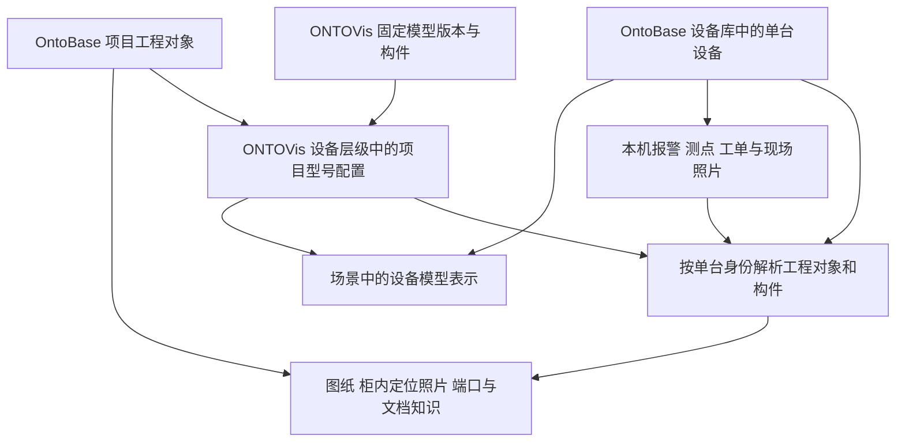

# 设备层级与设备库关系调整方案

2026-10-28用户批准并进入实施，承接2026-10-27修订。项目内共享的模型与工程对象关联统一在“设备层级”配置，实际安装设备归属 OntoBase 设备库，场景放置时关联具体设备。本文替代此前模型中心项目映射提案；服务边界见[实施契约](../plans/设备库与共享绑定服务契约.md)，实际部署和验收见[执行记录§124](../plans/开发执行记录.md#124-设备库与共享绑定配置实施2026-10-28)。

核心关系是：**工程对象提供共享工程依据，设备库记录实际设备，设备层级维护项目内型号映射，场景实例表达设备在某个场景中的位置与外观。** 同型号的设备复用映射和资料，单台身份、现场记录和时序数据分别保存。

## 当前问题与调整理由

当前 OntoBase 的安装接口把设备记录写入 `asset.entities`，通过 `object_scope=installation`、安装范围和来源定义指针区分身份；项目对象目录未指定安装范围时，同时返回非安装对象与安装对象。因此截图中的“主轴”和“夏李10号·主轴”等会进入同一分类。

此前为每台创建关键安装对象，是为了让单台报警、设备层级和空间定位有独立身份。这解决了不同机位不能混用同一设备身份的问题，却把设备台账混进了工程资料目录；也不意味着每个模型构件都需要独立设备台账。新的方案应同时纠正目录归属和自动建档粒度。

现状依据为 [执行记录§120](../plans/开发执行记录.md#120-场景连续缩放共享工程定义与模型中心绑定设计2026-10-27)、[§121](../plans/开发执行记录.md#121-夏李12台风机布置与整机关联2026-10-27)，以及部署版本对应的 OntoBase `f20baa10` 安装写入与项目目录代码。这是迁移前基线；本批设备库领域/API、ONTOVis设备层级入口、共享配置与迁移的结果另见执行记录§124。

## 四类数据与一个共享配置

| 内容 | 权威系统与维护入口 | 表达的含义 | 复用方式 |
|---|---|---|---|
| 项目工程对象 | OntoBase 工程对象库 | 设计对象、位号、分类、工程组成关系及其图纸、柜内定位照片、端口、知识节点等依据 | 一个项目的明确适用范围内共享；不因放置设备而复制 |
| 设备台账 | OntoBase 设备库 | 实际设备或明确标注的演示设备、编号、序列号、安装归属和检修履历 | 同一设备只有一个权威身份，可出现在多个场景 |
| 模型资源与固定版本 | ONTOVis 模型中心 | 几何、构件目录、属性、单位、校准与版本 | 模型文件可以跨项目复用，文件本身不携带某项目的权威绑定 |
| 场景设备表示 | ONTOVis 场景与可视化 | 模型在本场景中的放置、显隐、视角及其代表的设备 | 每次放置有独立场景实例，同一设备可有多种表示 |
| 项目型号配置 | ONTOVis 设备层级 | 某设备类型及型号采用哪些工程对象、哪些模型版本，构件如何对应工程对象 | 同项目、同配置的全部设备共用一份映射 |

“ONTOVis设备实例”在界面中表示某台设备的可视化实例。其真实设备身份来自设备库；ONTOVis不另建一份可独立修改编号、序列号和安装事实的设备主台账。场景实例ID只管理显示与放置，不能成为报警或工单唯一的设备ID。

同型号共享工程定义、映射，以及用于工程对象定位的柜内照片和标注区域。7号与18号的温度、故障、维修和各自设备的现场照片分别记录；共享定位照片不会改变这些记录的单台归属。

## 柜内定位照片与设备现场照片

按本轮用户明确要求，照片以用途和关联范围区分，不能仅凭拍摄地点、文件名或是否拍到柜内来判断归属。

| 照片用途 | 关联与保存方式 | 在同型号设备间如何使用 |
|---|---|---|
| 柜内工程对象定位 | 在 OntoBase 关联共享工程对象、照片固定版本及对象标注区域；项目型号配置引用适用照片 | 同项目同型号设备共享照片及标注；15台不复制15份照片或区域 |
| 设备现场记录 | 在 OntoBase 设备库的资料关联中归属具体设备或子设备，并保留拍摄时间、事件或工单上下文 | 各台独立；检修、缺陷、实物状态等现场照片按设备查询 |

例如7号与18号查看CN1中的1B4，可以打开同一张柜内定位照片，并定位到同一个标注区域；画布仍分别携带7号、18号的设备上下文。两台发生缺陷或检修时拍摄的现场照片各自保存，不因同型号而共享为本机记录。

设备层级中的型号配置统一引用柜内定位照片集合。原有“工程对象 → 照片区域”的权威关联继续由 OntoBase 维护，ONTOVis直接复用，不再为每台设备重新标注。型号内柜体布置发生实际变化时，在相应配置变体中指定适用照片版本。

画布和资料面板分别提供“对象定位照片”“现场照片”：前者按当前工程对象自动推荐，显示“同型号共享”；后者按当前设备推荐，显示设备名称和拍摄时间。没有本机现场照片时保留空状态，共享定位照片仍可正常查看，但不作为本机当前缺陷或检修结果的证据。

照片原始拍摄来源保持不变。同一张原图确有两种用途时，可以建立两种明确的资料关联，底层文件去重；不能因将其用作共享定位而抹去原拍摄设备，也不能因原图拍自某台设备而为其他每台复制文件。画布保存照片用途、适用范围、固定版本与标注区域，历史回读沿用当时引用。

## 项目型号配置的共享规则

一个配置至少明确所属项目、设备类型、型号或结构变体、工程对象适用范围、可用模型固定版本及构件映射。型号文字、模型文件名或同名构件只能帮助检索，不能作为配置身份。

以 Demo-PDS 的 TU-3000 测试配置为例：整机对应风机工程定义；内部包括 CN1机舱动力柜、CN2机舱信号柜、CT塔基信号柜，以及发电机、齿轮箱、主轴等共享对象。温度传感器1B4继续引用原工程对象及其已有图纸定位。同项目15台采用这一配置，无需建立15份构件映射。

当前1144个非安装共享来源不等于已经审核完成的一棵风机定义树。实施时复用已有三柜成员关系，并明确其余对象的适用范围；不能把所有非安装对象直接改成同型号模板。若缺少可用的共享整机定义，由 OntoBase 正常建档后引用，不用某台安装根代替定义，也不猜一个UID。

映射具有以下规则：

- 一个工程对象可以对应一组几何构件，例如柜门、柜架和内部外壳共同表示一个柜体。一个具体构件出现位置只有一个直接主对象；父总成与子构件的对应关系分别保留。
- 同一型号内部有两个相同设备时，以稳定的对象位置键区分，例如泵A/泵B、叶片1/2/3。位置键不取决于显示顺序；图纸若已区分对象，优先引用对应的独立工程对象。
- 工程对象没有独立几何时，保留对象身份，依据已有工程归属定位到柜体或总成。界面说明“定位到所属柜体”，不把柜体高亮冒充该传感器的精确几何。
- 模型节点父子只是几何组织。工程定义组成和实际安装父子关系由 OntoBase 维护；设备层级中的映射编辑不自动改变这两类关系。
- 同项目、同配置实时共用一个当前映射修订。一次“保存并应用”显示影响的设备与场景数量，更新该配置的当前修订，所有采用者刷新；不要求逐台保存15次。
- 历史分析和历史场景回放固定当时的模型、映射及设备上下文。新映射不改写旧画布证据；查看当前版本是独立动作。
- 模型不同版本分别维护构件映射。一份配置可以保留正在使用的多个模型版本的映射；更新某版本不能使其他正在使用的版本丢失关联。换型号或实际结构不同，应采用另一配置或明确变体，不能在某个场景偷偷覆盖共享映射。
- 跨项目可以复用模型几何，但不自动复用工程对象UID与映射。若后续需要复制配置，只复制结构与匹配候选，必须重新解析目标项目的对象。

这里的配置生效只代表可视化关联保存成功，不启用故障结论确认，也不把教学模型或示意柜体升级成已核实现场设备。

## 设备层级的操作设计

保留左侧导航名称“设备层级”，进入项目后可用。模块内提供 **型号配置**、**项目设备** 两个视图；首次配置进入型号配置，后续记住用户选择。

### 型号配置

顶部选择当前项目中的配置，例如“风机 / TU-3000”。左侧显示其共享工程对象层级；中间显示完整模型、构件树和属性；右侧显示所选对象的映射与关联资料。类型分类可以作为筛选方式，但不会把15台安装子对象混入这棵共享树。

操作顺序：

1. 新建或选择型号配置，确定工程对象范围。优先引用现有层级和资料关系；缺少工程定义时进入 OntoBase 补充。
2. 选中整机定义，点击“关联模型”，选择模型中心已有资源及固定版本。预览模型比例、方向和适用精度。
3. 选中内部工程对象，在模型构件树或三维视图中拾取、框选构件，点击“关联构件”。也可先选构件再选对象；两边选择交叉定位。
4. 右侧显示对象名称、构件数量、定位方式、已有图纸与手册。支持定位、仅显示、解除映射；解除不删除模型或工程对象。
5. “保存并应用”前常驻显示影响摘要，例如“此配置用于15台设备、12个场景表示”。一次保存产生新修订，服务端执行权限、版本及映射一致性检查。

已有关系推荐直接显示；只有新增映射需要搜索。支持“未关联”“已有直接几何”“通过上级定位”等筛选。正常操作不增加逐对象的二次核验弹窗；并发冲突、项目不符或构件缺失时保留选择并给出具体原因。页面使用“型号配置”“已保存”等业务文案，不反复展示“草稿”。

### 项目设备

按设备库的站场、区域、系统或设备树展示实际设备。夏李默认显示15台风机，点开一台才展示其内部结构，不再在“主轴”分类下平铺所有机位。

这里有两种子项：有独立台账的子设备，以及根据型号配置展开的工程对象。前者显示设备编号和履历入口；后者显示“工程对象”，携带当前整机上下文，不伪造独立设备台账。分类筛选和搜索仍可定位所有主轴，但结果明确所属设备。

可以查看采用的型号配置、在哪些场景表示、当前报警和相关资料。设备建档、序列号、物理安装关系及更换履历由设备库维护；ONTOVis提供对应入口。若以后允许内嵌编辑，仍调用 OntoBase 的授权业务接口，不维护第二份事实。

### 模型中心与旧构件绑定入口

模型中心继续管理上传、基本信息、版本、几何预览、构件树、属性与校准。项目对象绑定移至设备层级；在已进入项目时，可提供“在设备层级配置”跳转，携带模型及版本。未进入项目时先选择项目。

旧“构件绑定”独立入口在新功能与旧数据迁移完成后合并到设备层级；旧链接重定向至对应配置或明确显示待迁移关系。迁移完成前保留现有能力，不能先撤按钮导致已保存绑定不可查看。

## 场景布置与设备库关联

新增设备模型推荐从“项目设备”拖入，用户选中“夏李7号风机”即可取得其型号配置、默认模型版本并完成设备关联，随后调整位置。这个过程新增一个场景表示，不新增工程对象或设备台账。

从模型资源拖入也保留：先确定项目型号配置，再选择设备库中对应的实际设备。候选默认限定同配置、同项目的可用设备；信息展示已在哪些场景使用，避免误选另一台。普通场景中同一设备的重复主表示给出提示；需要概览与细节两种表示时显式区分用途。

以用户预留的15、16、18号为例，迁移完成后，这三台应在项目设备中显示“未布置”。拖入15号即可继承整机与内部构件映射，无需再逐个绑定柜体、主轴或传感器。

设备尚未建档时允许继续模型布置和查看共享工程资料，显示“未关联设备”。通过设备库入口正常建档后再关联；单纯复制或拖放模型不得自动创建真实设备。模拟报警使用明确的演示设备或模拟上下文，不伪称接入现场。

同一实际设备可以出现在风场概览、机舱检修和专题分析三个场景中。这些表示共用设备身份和工程映射，各自保存视角与放置。删除场景或移除模型只移除表示；设备台账、报警、工单及共享资料保留。复制场景也不创建新设备。

对于厂房、装置或线路整体模型，整模不必绑定一个虚构的“总设备”。项目配置把模型中的对象位置分别对应到工程对象，存在实际设备的部位再关联设备库记录；多个部位也可以共同表示同一设备。这与“一台风机使用一个整模”共用相同的引用原则，但不强制所有行业采用单根设备模板。

## 何时需要单独建立子设备台账

设备库用于回答“现场到底是哪一件设备”。需要序列号、独立检修、更换、移装或独立资产管理的发电机、变压器等，可以有自己的设备记录，并关联上级设备和安装位置。型号中存在某构件并不自动证明现场已有对应设备。

仅用于检索图纸、定位模型或读取一个测点的子对象，可以用 **整机设备身份＋型号中的对象位置＋工程对象引用** 表达。例如“7号风机 / CN1 / 1B4”，无需为15台风机复制15份1B4工程对象。以后确需独立管理某台1B4时，再在设备库建档并关联该位置，保留既有测点历史。

已有独立子设备台账时，根据设备库记录的上级、安装位置和来源定义接入这个位置；模型构件映射继续继承型号配置，不再逐台重做。若同一位置有多个有效设备或缺少明确对应关系，显示待关联，不用同名或同类型自动认定。实际安装、更换事实仍由设备库维护。

同一位置更换实物时，位置的运行时间线与新旧实物履历需要区分：设备库记录生效时间，历史报警仍保留发生时的设备或位置上下文；新设备不会继承旧设备的序列号身份。首批不扩展为完整维修资产管理系统，但引用结构不能把实物与安装位置混成同一个字段。

当前211个演示安装对象中，7号额外的“演示子设备 · 轮毂变桨系统24V及控制信号接口”用于早期无几何子设备定位验证，按本轮用户澄清，不再保留为活动安装对象。对应共享工程对象“轮毂变桨系统24V及控制信号接口”及其图纸依据继续保留；旧安装身份仅用于历史引用解析，不自动改写历史记录为共享对象。

按当前清理范围，其余210条记录迁入设备库，保留原身份与演示性质；额外1条退出活动台账，必要的历史记录仍可读取。210是保留已有测试数据的迁移数量，不代表今后每台必须创建14条台账。之后停止按每个模型构件自动建档，仅按独立设备管理需要新增。

## 报警与分析如何贯通

以7号风机的13001模拟报警为例：

1. 报警定位到设备库中的7号设备，并携带测点或内部对象位置。来源只提供同名位号、无法确定单台时，保留待关联状态，不能任选一台。
2. 使用7号采用的项目型号配置，解析到共享1B4工程对象，以及模型内的直接构件或所属CN1柜体。
3. 图纸、柜内定位照片及标注区域、对象分类、端口、连接关系和故障代码手册知识节点，按共享工程对象与型号适用范围读取。
4. 温度趋势、报警、工单和设备现场照片，按7号设备及当前对象位置读取；与共享柜内定位照片分别展示。
5. 画布保存设备身份、对象位置、工程对象、模型固定版本与映射修订。工程对象卡片只需一份来源，但可在不同设备上下文中使用。

同故障码历史画布仍可自动推荐，优先同项目、同设备配置和适用资料版本。调用历史分析时保留原设备和事件时间；采用为新分析后才按新设备重新关联本机数据，不把7号曲线复制成18号的现场读数。

后续自然语言交互沿同一关系解析。例如“看7号动力柜温度”先确定7号设备，再解析CN1与温度点；“所有同型号机组对比”展开设备列表，共用工程定义但分别读取数据。助手与画布使用同一解析服务，避免一套推荐逻辑、一套模型定位逻辑。

## 不同项目的适用方式

| 项目情况 | 工程对象如何使用 | 型号配置与实例如何处理 |
|---|---|---|
| 同型号风机、成套机组、标准泵组 | 一套明确适用的共享对象与资料 | 多台设备共用配置，各自绑定设备台账 |
| 同一项目包含不同型号或改造批次 | 不同配置引用各自适用的对象范围；确有共同依据的部分可共用 | 按型号或结构变体分配置，不凭外观相同强行共用 |
| 炼化装置、工厂产线中的唯一设计设备 | P-101、P-102等可能本来就是不同设计位号和图纸关系 | 可共用模型文件；工程映射按各自设计范围配置，不合并位号 |
| 铁路站场、变电站的重复柜型 | 柜型可相同，站别端口、回路和功能关系可能不同 | 几何可复用，工程配置按实际站场或结构差异区分 |
| 建筑、管网、轨道等连续或整体模型 | 模型可能包含多个系统、区段或独立工程对象 | 允许整体模型覆盖多个对象；真正被管理的设备或区段才绑定设备库，无需为每个网格创建设备 |
| 设计阶段或尚无设备台账的项目 | 先使用项目设计对象、模型与资料 | 允许未关联设备的场景表示；不生成虚构现场身份，运行数据待接入 |

因此“同型号共享”指工程结构与对象范围兼容的同一项目配置，不能仅以制造商型号字符串判断。项目专用工程对象也不必强行改造成跨设备通用模板。第一批用夏李落地，其他行业先遵守同样的身份与范围规则，不新增行业插件平台。

## 服务与存储的调整边界

下表为方案的逻辑记录；2026-10-28实施的字段、路径及权限以[服务契约](../plans/设备库与共享绑定服务契约.md)为准。设备更换、完整资产履历等扩展仍为设计约束，不由表中逻辑记录推定已上线。

| 逻辑记录 | 保存方 | 关键约束 |
|---|---|---|
| 工程对象及其资料关联 | OntoBase 工程对象域 | 保留现有UID、分类、图纸区域、共享柜内定位照片及区域和证据链，默认目录不返回设备库记录 |
| 设备记录与实际安装关系 | OntoBase 设备库域 | 独立业务查询、维护和计数；设备身份、父子关系、有效期与本机现场照片关联独立于场景 |
| 项目型号配置及修订 | ONTOVis 项目域 | 项目、工程对象范围、模型固定版本、稳定构件键及对象位置；一个当前修订供采用者共享 |
| 设备采用配置关系 | ONTOVis 项目域 | 设备库引用与配置ID对应；不复制设备基本信息；一个设备的各场景采用一致配置 |
| 场景表示 | ONTOVis 场景域 | 场景实例、配置引用、模型固定版本、放置及显隐；单设备表示关联整机，整体模型按对象位置解析设备，无记录时明确未关联 |
| 信号与分析上下文 | 既有 ONTOVis 数据映射及分析域 | 单台设备或位置、来源测点、时间、共享工程对象及当时映射修订；场景ID只作展示引用 |

工程对象引用与设备库引用在接口中区分类型，均包含源连接及项目范围。迁移可以保留原UID字符串，但消费者不能因此把设备引用当成工程定义引用。已有字符串引用由源系统的受控解析识别，不以名称或前缀推断身份。

设备库需要独立的业务集合与持久化主体，不能只在原混合列表上增加一个隐藏筛选。可以与工程对象库使用同一 PostgreSQL 实例和现有权限、审计基础，不需要另部署一套数据库服务。物理迁移涉及既有外键和历史引用，须先完成引用改造；过渡旧记录只能用于兼容读取，不保留两份可写设备主数据。

ONTOVis只通过 OntoBase API读取、关联或发起已授权的设备业务动作。设备库自身的数据迁移由 OntoBase 受控迁移完成，不由 ONTOVis 脚本直接写其数据库。各写入沿用项目权限、预期修订、幂等与事务检查，不新增逐张照片或每次模型读取的人工核验。

## 性能要求

- 项目型号配置按修订缓存，同一配置用于15台时只读取一份映射。模型几何按固定版本复用；每台仅增加放置矩阵和设备引用。
- 工程对象库与设备库各自提供服务端分页、分类计数和范围搜索。设备树展开后才读子项，不先拉全项目再由浏览器过滤。
- 报警先带入具体设备及对象位置，批量解析相关资料和构件；避免对15台逐项递归请求全部1144个共享来源。
- 更新映射只使相应项目配置的缓存失效。图片和模型内容沿已有固定版本缓存，不因映射变化重传整个文件。
- 共享柜内定位照片按固定版本复用预览、原图及标注缓存；在7号与18号间切换只改变设备上下文，已缓存内容不重复下载。设备现场照片清单继续按设备身份隔离。
- 验收分别记录冷读、热读、首屏与完整几何就绪时间；在实际部署环境测量。接口正确不等于照片或模型已呈现，也不预先宣称达到某秒数。

## 现有夏李数据的迁移方案

迁移前测试数据基线为1144个非安装共享来源，211个安装对象，15个安装范围；211由15个风机根、45个柜体、150个主要设备及原7号额外接口子对象组成。原始1133个来源及后来补充的CT和10个主设备定义保持。三柜口径固定为CN1动力、CN2信号、CT塔基信号。

调整后为210条活动设备记录加1条退出活动台账的历史身份。7号额外安装UID为`entity:2007239f-8cc5-4514-9617-b3ae7b1e5995`，共享来源UID为`Demo-PDS:OBJ:b64ce8347f28`；清理范围只针对前者。已布置12台对应168条活动记录，预留3台对应42条，历史额外1条另计。

### 第一步 只读盘点和明确归属

按明确的安装范围与对象身份生成迁移清单，列出每个安装UID的定义来源、上下级、场景、报警、工单、画布和证据引用。不得依靠“夏李”名称批量识别、删除或合并。确认哪些历史记录没有来源定义，作为可见缺项保留。

盘点同时覆盖直接依赖 `asset.entities` 的外键、旧安装接口、图谱、资料读取及历史引用，不能只检查前端目录。原211个安装记录保留演示性质，不因迁入设备库而认定为现场核实资产。

### 第二步 建立设备库边界并迁入记录

由 OntoBase 实现设备库领域及接口，将保留的210条安装记录、所属范围和安装关系移入设备库；7号额外接口子对象退出活动台账，保留必要的历史记录和旧引用解析。优先保留原UID，避免已有12个场景整机关联和历史分析失效。

为需要迁移的旧读者提供有限的兼容读取；新建和编辑设备统一进入设备库。工程对象目录的分页、分类计数、搜索和选择器同时排除安装记录。迁移结束后，旧存储只保留必要的历史与引用解析；不把整份安装记录继续作为一份活跃工程对象维护。

保留原图纸、照片、文档与知识节点的引用。已有用于工程对象定位的柜内照片及标注作为共享资料引用；各设备的现场照片按设备保留。若同一原图需增加共享定位用途，新增明确关联，不改写其原拍摄来源或历史设备证据关系；不按文件名批量推断用途。

### 第三步 建立项目型号映射并接入场景

在设备层级建立 Demo-PDS 的 TU-3000 配置，核对共享整机定义、三柜与主设备；配置构件映射。原模型只有示意代理的位置继续标记示意，不新增所谓精确柜体几何。

将15台设备采用该配置，12个已布置实例改为设备库引用，保留模型版本、实例ID、经纬度、朝向、地形、影像与视点。既有逐实例构件映射仅在相同固定版本、共享定义与构件键均一致时合并为共享配置；有冲突保留旧关系并列差异，不按名称覆盖。

原场景保留1、4—14号这12台；15、16、18号保持未布置，继续留给用户测试。模型中心的项目绑定入口及旧独立构件绑定页随后收敛到设备层级。

### 第四步 验收与切换

先在备份副本验证迁移、旧引用读取与回退，再切换实际测试环境。切换后保留新写入和新的配对备份，回退不能用旧备份直接覆盖新业务记录。历史快照保持原内容，通过兼容解析读取旧身份；不批量改写已保存画布与场景历史。

验收至少覆盖：

1. 工程对象目录不再混入211个安装对象；1144个共享来源的UID、原分类和资料关联保持，未遗漏原范围未分类对象。
2. 设备库活动记录为15个风机根及195个原有关键子设备，共210条；7号额外接口子对象不进入活动目录，但历史引用仍可解析。界面默认按台展示，子项按需展开。
3. 一个项目配置同时用于两台以上设备，修改一次映射后全部采用者一致更新，无15份重复配置。
4. 同一模型用于两个项目时，工程映射、设备列表与访问权限相互隔离。
5. 7号与18号的1B4使用同一图纸、柜内定位照片及标注区域，缓存内容不重复下载；报警、趋势和设备现场照片互不串用，画布保存并区分两种照片用途。
6. 同一设备出现在两个场景、场景复制及删除后，设备身份和历史数据保持。
7. 同型号内重复部件、无几何对象、实际设备更换及不同结构变体均能消歧，不能任意选择一个同名对象。
8. 模型换版、缺失构件、并发保存与重复提交产生可解释结果，不静默覆盖旧映射。
9. 原12台坐标、整机关联、固定模型和场景环境保持；15、16、18号可从项目设备拖入并继承映射。
10. 旧工单、画布、照片和场景历史可回读，原UID兼容解析不会扩大项目权限。
11. 同型号多台只复用一份模型和映射，目录与树没有逐台全量读取。
12. 迁移前后数量、关系、资料及历史引用核对通过，失败恢复不丢失切换后的写入。

## 建议实施顺序与评审结论

建议按四个切片推进：**设备库与工程对象目录分离 → 设备层级的项目型号映射 → 场景设备关联及12台迁移 → 报警与画布使用同一身份解析**。每片都有独立可操作页面和验收，不以后台表结构完成代替产品可用。

本方案建议确认三个具体选择：项目绑定统一迁至设备层级；实际设备统一归 OntoBase 设备库且子设备按管理需要建档；旧记录中210条迁入设备库，7号额外1条退出活动台账并保留历史引用，停止按模型构件自动生成设备。型号共享的生效方式为一次保存应用至同配置全部实时采用者，历史分析固定原修订。

用户于2026-10-28批准实施。ONTOVis既有MagicPath工作台已更新，OntoBase本批实现设备库领域/API，由ONTOVis“项目设备”提供可操作入口，未另行发布OntoBase Web资产维护工作台。完整资产履历、设备更换管理和不同结构变体的专家确认不作为已上线能力；保留本方案作为后续扩展约束。

## 2026-10-28实施结果与边界

OntoBase以独立设备主记录维护当前设备属性，原安装UID保留为外键及历史兼容锚点，旧工程对象行不再是可写设备主数据。工程目录默认排除安装记录，原1144个工程对象保持，正常API补建1个整机工程定义，共1145个。210条有效设备记录及1条停用历史身份已回读；没有按台复制全部共享工程对象。

设备层级已提供型号配置与项目设备视图。15台采用一份配置，含13项内部工程对象映射，其中12项有直接构件；转子缺少有效整体键，保留无直接几何及整机范围。CN1/CT为示意代理，CN2采用既有控制器分组。柜内对象沿原成员关系定位至柜体，不推定单个传感器拥有精确三维网格。

原夏李12台的场景快照逐字段保持，正常保存仅捕获新的设备条件和配置修订；15、16、18号在线仍未布置。隔离副本已完成一次设备原生拖入、保存及共享映射回读。当前场景使用配置当前头，历史场景按保存记录固定修订；新模型资料引用保存配置修订与采用设备范围，旧画布不自动增加新事实。

共享柜内定位照片沿原对象、版本和区域读取；现场照片关联通过设备库API独立归属本机。缺少可确认的现场照片时显示空状态，本批没有给演示设备伪造实拍记录。快速预览与原尺寸分别读取，同一面板重复打开保留内容缓存；不同设备的照片清单依然分别授权读取。

本批验证了项目范围、重复构件占用、并发与幂等、停用身份回读、不同设备定位、旧画布及成组恢复。完整设备更换时间线、跨型号变体确认、任意重复安装位置建档及完整OntoBase资产工作台仍是后续能力；不把上面的规划验收条目全部计作本批已实现。当前操作见[指南](../guides/设备库与共享绑定操作指南.md)，实际测试版本与证据见[记录§124](../plans/开发执行记录.md#124-设备库与共享绑定配置实施2026-10-28)。
