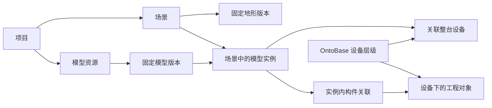

# 场景管理与模型实例统一实施方案

**V2 · 2026-10-22 · 供整体设计评审。** 按“项目模型资源 → 场景中的模型实例 → 设备及内部构件关联”统一建设。用户可以创建场景、上传地形，将同一模型放置多次，为每个实例设置位置和关联设备，再进入同一工作台处理内部构件与项目对象的关联。

本轮交付实施方案。后续页面继续在现有 MagicPath「ONTOVis 产品设计」中设计，当前工作台修订为 `463816427544121344`；保留灰绿深浅配色、默认收缩导航、紧凑间距和中英文。停用、退役暂缓；本机空间连续导航 Demo 只提供交互与数据处理参考。

2026-10-22计划整合：本文保留场景行为、服务边界与验收要求；执行状态和顺序统一维护在[统一任务队列](统一任务队列.md)。SC-01—06映射Q-01—06，SC-07/08映射Q-07/08，SC-09映射Q-18，不再独立排期或重复计工时。

## V2修订重点

对照优锘ThingJS-X、图观与51WDP官方资料，补齐场景编辑和资源复用的实际操作，同时承接已有图层、视角、版本与实时数据设计。证据及新旧需求区分见[国内平台能力对照](../references/国内数字孪生平台场景能力对照.md)。

| 范围 | V2调整 | 落点 |
|---|---|---|
| 首批补齐 | 资源搜索/缩略图/处理状态、尺寸和基点预览、资源使用去向、换版预览 | SC-01/03/04 |
| 首批补齐 | 场景内容显隐、锁定、搜索；落地、俯视、定位选中；初始与返回视角 | SC-01/04 |
| 首批补齐 | 本地草稿与已保存查看修订分离；后台渲染和多实例内存验收 | SC-03/04/06 |
| 后续新增 | 多选编组、批量布置、吸附、命名视点及相机巡游编排 | SC-07 |
| 后续承接 | 独立影像/地图图层、状态和动画映射、有限模板复用 | SC-08/09，与既有WBS衔接 |

保持实例身份独立、OntoBase权威层级、无几何子设备定位、坐标高程及版本核验规则。竞品中的点位自动建账、通用蓝图和云渲染平台不纳入本批。

## 1. 从现状调整什么

| 事项 | 当前实际能力 | 本次目标 |
|---|---|---|
| 模型上传 | 私有静态 GLB，单文件20MiB；每次上传是一条版本记录 | 模型资源有自己的版本列表，同一版本被多个实例引用 |
| 模型库范围 | 固定项目和7号设备上下文 | 项目级资源，不依赖某台设备；首批仍在 Demo-PDS 验证 |
| 场景 | 工作台单模型预览，尚无正式场景管理 | 场景列表、创建、编辑、保存和重新打开 |
| 模型关联 | 关联挂在模型版本上，仅允许7号三柜 | 每个实例独立关联整设备及其内部对象 |
| 空间定位 | 单模型内三柜与无几何子设备定位 | 场景中找到正确实例，再定位内部构件或已关联祖先 |
| 工程权威 | OntoBase 提供对象、分类、物理层级和图纸 | 继续通过其 API 读取；场景编辑不改写工程层级 |

依据为[已实现上传切片](模型上传与演示关联切片.md)、[模型库代码](../../apps/api/model_library.py)、[当前服务](../../apps/api/workbench_server.py)与[视口](../../apps/workbench/src/ModelViewport.tsx)。旧整体设计已提出实例级绑定，本方案细化它，并覆盖后来首切中的“固定单机、固定三柜、版本级关联”限制。

## 2. 用户需要理解的五个概念

| 界面名称 | 含义 | 示例 |
|---|---|---|
| 模型资源 | 上传一次、可反复使用的模型及版本 | 某型号风机模型、箱式变压器模型 |
| 场景 | 一个项目内保存的空间布置 | 夏李风场总览、升压站设备区 |
| 地形 | 场景使用的地表高程数据 | 指定区域的一份 GeoTIFF 地形版本 |
| 场景中的模型 | 模型资源的一次放置，技术上称实例 | 7号风机、8号风机、1号变压器 |
| 关联设备 | 此次放置代表的 OntoBase 工程对象 | 7号机组及其 CT、CN1、CN 等对象 |

同一个风机文件可放置多次。每次放置都有独立名称、位置、朝向和设备关联；共享文件和构件目录，不共享设备 UID。一个场景可以包含多台设备及多个设备上下文，场景 ID 不等于 OntoBase 的设备上下文 ID。

## 3. 场景与绑定使用同一套工作台

保留原管理入口，将“场景与可视化”首批开放为“场景管理”；“模型中心”管理文件和版本，“构件绑定”进入选定场景、选定实例的内部关联。两处共享选中对象、模型实例、相机和关联结果，避免各做一套绑定逻辑。

| 页面或区域 | 主要操作 | 设计要求 |
|---|---|---|
| 场景列表 | 创建、打开场景；显示名称、模型数量、最近保存时间 | 首批不增加发布流程或大面积说明卡片 |
| 场景编辑左栏 | “场景内容 / 模型资源 / 项目对象”三个页签 | 内容可搜索、显隐和锁定；资源可重复拖入；项目对象沿用分类与设备树 |
| 中间视口 | 选择、放置、移动、旋转、落地、俯视、定位选中、适合全场 | 单一视口，明确区分浏览模式和布置模式；更多操作按需展开 |
| 右侧属性 | 实例名称、资源版本、位置、朝向、关联设备 | 默认展示业务字段；坐标来源、精度和版本放按需展开区 |
| 构件绑定 | 选中实例后进入内部模型，选择构件与设备树对象建立关联 | 顶部持续显示场景和设备名，支持返回场景并恢复视角 |
| 工程对象详情 | 设备路径、空间定位、属性和图纸 | 选择无几何子设备时仍显示其自身资料 |

### 模型资源先核对，再放置

资源列表提供缩略图、名称/用途搜索、处理状态与版本入口。用途先用“设备模型 / 场景简模 / 环境模型”，它是资源筛选字段，不替代OntoBase对象分类。处理中或失败的资源不能拖入；保留可读失败原因和重试入口。

资源预览可显示尺寸、坐标轴、放置基点、正面方向以及有无构件目录。单位或基点未核对的资源可以查看，但不进入有地理参考的布置；管理员完成校准后生成可用版本。首批仍沿用静态GLB范围，不因竞品支持模型动画而放开未经验证的动画上传。

资源版本显示“用于哪些场景、多少实例”。当前使用与保留历史引用分别统计；已有场景不跟随资源最新版本自动更新。替换前在本地草稿中预览几何、尺寸、关联和位置影响，取消后恢复；只升级选中的实例。保留快照仍引用的文件不得自动清理，也不在本批引入资源归档管理。

### 创建场景和上传地形

1. 选择项目，填写场景名称。先创建空场景，允许在带尺度的平面上整理模型；没有地理参考时显示“未设置位置”。
2. 点击“添加地形”，上传文件。系统读取覆盖范围、坐标系、分辨率、高程单位及缺测范围；已识别字段只需核对，缺失信息才要求补充。
3. 展示处理后的地形预览与简短结果。确认使用后将地形版本固定到场景；首批一个场景使用一份基础地形。
4. 地形默认保持真实起伏比例，可选择纯色或草地外观。草地是显示材质，不表示卫星影像或实际地表分类。

### 布置同一模型的多个实例

1. 从“模型资源”拖入视口，落点生成半透明预览；在有效地表释放后创建一个未关联设备的实例。也提供“添加到场景”按钮，方便键盘、触屏和精确输入。
2. 选中已放置模型后，在布置模式拖动位置或调整朝向；右侧经纬度同步更新。修改经纬度并应用时，模型移动到同一份位置数据对应的地点。
3. 默认为“贴地＋高度偏移”。模型基点落地，保持竖直；不会自动随坡面倾斜。需要时切换为“指定高程”。
4. “复制”只复制模型版本、外观和放置设置，进入选择新落点状态，设备及内部构件关联默认清空。一个文件可产生多个实例，无需再次上传。
5. 拖动期间只更新本地草稿，释放完成一次可撤销操作。点击“保存”后统一持久化；刷新、离开或切换场景前提示未保存修改。保存失败保留草稿，不显示成功。

首批提供平面/轴向约束、精确字段、重新贴地和撤销/重做；Escape取消当前拖放。浏览模式只选择、定位和查看资料，布置模式才出现移动/旋转手柄。锁定实例仍可查看、定位和关联，解除锁定后才能拖动或修改位置/朝向；锁定状态不是权限。多选批量变换、编组和网格/角度吸附放入SC-07，首批不暗中扩展。

### 场景内容、视角与查看版本

- 场景内容首批按“地形、设备模型、环境模型”组织，行内提供显隐，模型实例另有位置锁定。地形的地理配准不通过拖动编辑。此处只是画面组织；项目对象分类与设备物理层级继续分别显示，移动列表或后续编组不改变工程父子关系。
- 浏览时显隐属于个人临时状态，“显示全部”可恢复；布置模式的默认显隐和锁定随场景保存。定位隐藏对象时临时显示其表示并用轻提示说明，保留原显隐以便恢复；不把隐藏当成无几何或无权读取。地形隐藏后仍使用固定地形做有效区域判断和贴地采样。
- 提供“适合全场”“俯视”“设为初始视角”。初始相机、默认显隐、简洁背景与光照预设随场景修订保存；主题影响控件配色，不改变工程数据、模型材质和光照预设。首批不开放后期特效编辑器。
- 进入构件前记录相机与临时显隐，返回恢复。切换构件从当前镜头平滑过渡；用户拖动可中断，减少动态效果时直接定位。离开场景或目标资源已失效时清除不适用的返回状态。
- 打开场景固定当前已保存修订。别人保存后仅提示“有更新”，由查看者主动重新载入；不中途换模型或移动设备。本人草稿仅自己可见，保存成功才产生其他成员可读的修订；浏览模式预览自己的草稿时显示“未保存”。不会另设发布审批流程。

### 从整设备关联进入内部构件关联

1. 选中实例，点击“关联设备”，从当前项目的对象分类或设备层级中选择风机、变压器等实际设备。
2. 整模型可直接代表该设备。变压器等简单模型完成此步即可使用，不要求具有风机的三柜结构。
3. 需要内部定位时点击“关联内部构件”：同一视口平滑进入模型，左侧展示该设备的已记录子树，中间选模型构件，右侧确认工程对象。
4. 风机实例分别将 CT、CN1、CN 构件关联到这台风机的三个柜级对象。另一台风机使用同一资源时，选择它自己的柜体 UID。
5. 可复用固定模型版本目录中的构件名称或角色，例如CT/CN1/CN对应的柜体角色，辅助下一台选择；具体对象仍按当前设备重新读取和确认。首批只复用已核对的角色提示，不建设独立模板库。名称相同、图纸相同不自动生成父子关系或绑定。

这里有三种不同关系：模型版本与构件角色说明“模型能表示什么”；场景实例与设备UID说明“这一次表示谁”；后续指标来源与设备的关联说明“状态数据来自哪里”。复制实例可带角色提示，必须清空设备UID、内部关联和设备测点引用。运行数据映射在SC-09承接已有设计，不与几何关联混成一个确认动作。

## 4. 设备层级和空间定位规则

采用两层关联：**实例整体关联设备，实例内构件关联该设备自身或其已记录后代对象。** 工程对象可以处在不同物理层级，例如机组、机组下变压器、站内独立变压器；不以 `objectKind=cabinet` 作为唯一准入条件。整模型关联要求可确定的实际设备身份，型号定义可作参照，不直接冒充已安装设备。

| 情况 | 行为 |
|---|---|
| 点击已关联内部构件 | 选中其工程对象；未关联外形回到实例整体关联的设备 |
| 选择有直接几何的工程对象 | 在当前场景找到对应实例和构件，平滑定位 |
| 选择无几何子设备 | 在该设备已记录的完整物理祖先链中，定位最近可用表示；保留子设备选中身份和图纸 |
| 最近祖先关联失效、关系不完整或存在歧义 | 显示原因，停止定位，不跳到其他机组或越过失效近层祖先 |
| 设备树中没有所属关系 | 显示“未关联设备”；不能按电气连接、图纸名称或空间邻近补造关系 |
| 同一设备位于多个场景 | 优先当前场景；当前场景没有时列出有权查看的场景供选择，不自动飞走 |
| 同一设备在当前场景有多个独立表示 | 让用户选择表示；首批不建设自动主表示规则。一次选择固定实例后再继续内部定位 |
| 改变实例关联的整设备 | 预览受影响内部关联；原子清空旧设备的内部关联后关联新设备，不保留跨设备混合状态 |
| 从场景移除实例 | 只移除本场景的放置和关联，不删除资源或 OntoBase 设备，也不代表退役 |

同一实例同一构件仅允许一个主要工程对象；同一对象可由多个构件共同表示。多个构件组成一个对象时合并高亮和边界，区别于多个独立场景实例。根设备与内部构件有层级重叠时，明确“构件优先、整设备兜底”的拾取顺序。

从项目对象树发起定位时，先在当前场景寻找该对象的直接表示，再沿完整物理链查找最近祖先；上一次选中的模型不能隐式限定搜索范围。例如同场景同时放置风机和其下变压器独立实例，选择变压器内部无几何设备时，应先找到变压器，不能因为刚看过风机而定位整台风机。只有用户明确选择某个表示，或从该实例的内部关联界面发起操作，才携带实例限定；限定仍须通过设备子树校验。最近祖先有多个表示时先选择，存在失效关联时保持原停止规则。

更换某个实例的模型版本时，旧内部关联始终属于旧版本，不因同名或相同 `componentKey` 自动复用。经验证的稳定源身份只生成迁移候选；版本内键或缺失构件必须重新关联，未完成前该对象停止直接定位。旧关联以历史记录保留，新场景修订中不作为有效绑定；其他实例和旧保存修订继续使用原版本。

子设备定位的返回结果必须同时包含所选对象、定位宿主、场景、实例、构件集合和定位方式。柜体示意、候选几何、假定物理关系沿用当前标识；当前演示可预览假定关系，不能升级为已确认工程关系。规则承接[三柜与子设备定位契约](../contracts/三柜绑定与子设备定位契约.md)。

## 5. 地形文件和坐标处理

### 首批格式和处理链

建议首批接收带地理参考的单波段高程 GeoTIFF（`.tif/.tiff`，DEM 或 DSM）。已有夏李数据可作验证样本；普通图片、地图截图和无地理参考模型不能自动识别为真实地形。多文件拼接、点云、任意压缩包、CAD 地形和3D Tiles导入留到后续实际需求。

处理链为“私有原件 → 元数据/资源检查 → 坐标与高程检查 → 有限范围裁切、重采样 → 地形分块网格和多级细节 → 处理报告 → 场景引用固定版本”。沿用现有受限子进程方式增加地形处理任务，不把大栅格解析放进请求线程或浏览器主线程。

首批建议以不超过256MiB、最多1600万输入像元作为预检限额候选，输出网格另受总三角形与内存预算限制；SC-02实测现有服务器后冻结。模型现行20MiB限额保持独立，不直接套给地形。文件尺寸、解压像元、波段、CPU、内存、时长和并发都需有界；失败能重试且不会替换正在使用的地形。地形和模型采用独立容量配额。

地理参考需要同时检查坐标系和像元到地理位置的变换；缺测区域保留掩膜，不填成0米。高程重投影须明确是否应用垂直转换及使用的格网，避免重复偏移。依据：[GDAL 栅格数据模型](https://gdal.org/en/stable/user/raster_data_model.html)、[GDAL 重投影与高程转换](https://gdal.org/en/stable/programs/gdalwarp.html)。

### 同一份位置数据驱动两种编辑方式

- 经纬度界面使用明确的“经度、纬度”字段，交换统一为 WGS84、顺序 `[longitude, latitude]`。未知坐标系不能默认为 WGS84；高德 GCJ-02 数据不能直接混入。
- 场景保存固定地理参考、渲染原点和高程基准。首批区域编辑采用明确记录的局部投影米制坐标；Three显示为 X东、Y上、Z南。经纬度转换与反算由同一锁定的处理规则完成，不把经纬度数值直接当米，也不把此投影坐标标为严格ENU。
- 空场景已在局部平面放置模型后，首次添加地形不能自动把布局原点放到地形中心或经纬度零点。保留布局为“未设置位置”，通过指定局部点对应的地理锚点和朝向预览整体变换；确认后一次保存。未确认前可继续局部编辑，但地理坐标定位保持不可用。
- 本地投影只承担区域编辑。以后对接地球/ECEF/ENU时，按既有坐标契约补齐椭球高及大地水准面转换；不能直接把当前EGM2008正高当作椭球高。保存原始基准与转换记录，使后续转换不依赖屏幕位置。
- 已设置地形地理参考时，拖动地表命中点反算经纬度；输入经纬度后用同一转换定位。超出地形覆盖或落入缺测区时明确拒绝“贴地”；可以选择有效点，或在坐标基准有效时明确使用指定高程。
- “贴地”保存地形版本、采样位置、固定采样高程和高度偏移。改变视角或细节级别不重新改变设备高程；显示网格在设备接地点与采样面保持一致。
- “指定高程”保存高程值和基准。已知地形与未知设备高程基准不做隐式转换；信息不足时仍可使用明确标注的相对贴地布置，不提供有误导性的绝对高程或工程量测。
- 替换地形先显示受影响实例和高度差，提供“保持现有高程 / 按新地形重新贴地”选择；确认后一次保存场景修订。指定高程的实例默认保持原值，变更基准必须显式转换。
- 模型版本记录米制单位、轴向、放置基点和校准变换；默认采用经核对的底部基点。首批实例编辑只开放位置、高度和朝向，避免误缩放真实设备。校准更改形成新版本，旧实例不自动挪动。
- 朝向使用真北为0°、顺时针增加；投影网格方向需处理子午线收敛角。安装朝向与风机运行偏航、叶轮转速分开，移动或旋转整台设备不改写运行参数。

地形粗分辨率表示整体地貌，不等于基础标高或柜体精度。已知基础标高优先；贴地布置标为地形估算。原[技术栈坐标合同](../design/技术栈与实时接入设计.md#53-数据坐标与高程合同)的来源/基准/精度要求继续适用；局部投影区域编辑是本方案拟新增的显示路径。

地图影像与地形分开管理：DEM/DSM提供高度，正射影像或地图瓦片提供地表图像，道路/边界属于独立矢量层。首批只做地形与简单材质；SC-08承接原WBS17的影像路径，保留各自来源、许可、坐标、覆盖和版本。不能把竞品的“地形服务地址”解释成已验证任意GeoTIFF上传，也不在首批加入会改变真实地形的“拍平”工具。

## 6. 服务与数据调整

以下为拟议接口及字段，不是现有能力。首批继续采用现有同源会话、项目成员读取/管理员写入和私有文件服务，使用 Demo-PDS 项目验证；不引入跨项目素材市场或新的角色体系。

### 数据归属

| 逻辑记录 | 核心内容 | 首批保存方式 |
|---|---|---|
| 模型资源 `modelAssetId` | 项目、名称、用途、来源、版本列表 | 新增资源记录，原版本挂在资源下；缩略图及使用去向按授权返回 |
| 模型版本 `modelVersionId` | 不可变文件、指纹、构件目录/角色提示、报告、校准信息、预览制品 | 承接现有私有版本与文件，不在关联时修改模型内容修订 |
| 地形版本 `terrainVersionId` | 私有原件/派生、来源、坐标/高程基准、覆盖、分辨率、掩膜、处理记录 | 独立资源记录和有界任务状态 |
| 场景 `sceneId` | 所属项目、名称、最新保存修订 | 可检索的场景摘要 |
| 场景修订 `sceneRevision` | 固定地形、地理参考、实例/关联、初始相机、默认显隐和背景/光照预设 | 一份有界快照，保存时在同一事务内校验并写入 |
| 模型实例 `sceneModelInstanceId` | 名称、模型版本、位置、朝向、贴地参数、锁定、整设备关联 | 首批放在场景修订内；稳定ID跨修订保留 |
| 实例构件关联 | 实例ID、构件键、工程引用、对象/层级修订、质量和来源状态 | 同一场景快照内保存，唯一性由后端事务检查 |

场景引用的每个实例独立记录其设备上下文，场景内可以有多个上下文。工程引用继续使用 `{ontobaseConnectionId, projectCode, entityUid}`，身份和层级修订由后端向 OntoBase 获取，不采信浏览器自报权限或完整父链。

首批用场景级 `expectedSceneRevision` 防并发覆盖，避免同时建设三套实例/绑定编辑版本。浏览器维护未保存草稿和撤销记录；保存一次形成新的不可变场景快照，原子包含放置与关联。版本冲突返回可读差异，保留本地编辑，不自动覆盖别人修改。历史快照用于追溯和迁移保障，本批不建设完整历史回放界面。

在当前单机测试服务上扩展现有私有SQLite即可，避免场景功能与数据库平台迁移捆绑；写事务、schema迁移、备份和并发检查必须补齐。正式多进程部署按原架构单独迁到PostgreSQL，不能让多个进程各维护独立场景真值。

### 服务契约草案

| 拟议能力 | 主要输入 | 核心行为 |
|---|---|---|
| 场景列表/详情/创建 | 当前项目、场景名称或 `sceneId` | 返回有权场景和保存修订；场景名称不承担身份 |
| 地形上传/任务查询/使用版本 | 原始文件、来源说明、上传请求ID；后续 `terrainVersionId` | 实际校验、异步有界处理、授权私有读取，失败可恢复 |
| 保存场景编辑 | `sceneId`、期望场景/会话修订、用户审阅时的对象及各设备上下文层级修订、幂等请求ID、明确编辑操作 | 原子校验增删实例、变换、地形/关联、默认视图和锁定；不接受任意JSON路径修改 |
| 候选设备及关联核验 | 场景、实例、拟关联设备和构件键 | 按项目及实际设备子树核验，返回对象/层级修订与问题 |
| 场景定位 | `sceneId`、所选对象、可选明确实例、期望场景修订 | 返回直接/祖先定位、实例和构件集合，或歧义/不可定位原因 |
| 资源内容读取 | 当前会话及明确资源版本/指纹 | 检查当前项目权限和资源归属，按固定版本返回私有模型或地形块 |
| 资源检索/使用去向 | 当前项目、名称/用途、资源版本、分页条件 | 返回处理状态、预览与尺寸摘要；查询当前及保留历史场景引用，不泄露其他项目名称 |
| 换版预检 | 场景/实例、候选模型或地形版本、期望场景修订 | 返回受影响关联/位置和不可迁移原因；预检不写入，最终保存仍执行全部校验 |

正式路径及请求响应在SC-01冻结，沿用 `/api/workbench/` 分组；不在本轮用未实现URL冒充可调用服务。旧接口仅在迁移期映射到唯一兼容场景实例，遇到多实例不能猜测默认目标。

保存关联必须同时核验：当前项目写权限、实例/模型/构件存在、对象当前可读且可关联、整设备身份、内部对象属于完整设备子树、对象/层级版本、同实例构件唯一性。候选核验结果返回对象及各设备上下文的修订，保存时带回用户审阅的期望修订；后端与当前权威数据逐项比较，不能取最新版本替用户接受已变化的身份或父链。场景级修订只负责本地并发，不能替代这些工程修订。

服务在处理开始和本地提交前再次授权；会话失效、项目撤权、写权限丢失均拒绝整次保存并回滚，不能降格为“保存成功但待核实”。本次提交发现对象或父链修订变化也拒绝，要求重新读取审阅。外部权威和本地保存不存在跨库原子事务；提交后的工程变化使已存关联需重新核实，运行定位再次验证，撤权立即阻断读取。退出与迟到响应清理沿用现有机制。

同一模型文件在客户端只下载、解析一次，实例共享几何/贴图；被选中的实例使用独立高亮状态，移除一个实例不能释放其他实例仍在使用的资源。拾取键必须是“场景＋实例＋构件”，所有构件包围盒先应用完整实例变换再参与相机定位。

远景按几何/材质和语义边界合批，支持时使用实例化绘制；只让选中的设备进入细模交互，不同时为全场设备保留独立高成本选中材质。Three.js 的实例化可复用相同几何与材质、降低绘制调用；仍需验证实例拾取、边界更新与资源释放。[Three.js InstancedMesh](https://threejs.org/docs/pages/InstancedMesh.html)

同一实例可使用已验证、坐标和基点一致的简模/细模表示；首批没有可靠对应关系时，远景使用由当前版本生成的简化表示，不靠相同名称拼接两个资源。进入细模保持实例ID和设备身份，返回不重置整场视角。场景不可见或浏览器进入后台时停止不必要的持续绘制；打开资料不得反复下载、解析模型。退出/撤权清理私有数据和缓存引用，不能为了复用缓存延长权限有效期。

## 7. 已有7号数据如何迁移

1. 备份现有库、私有文件引用和审计，记录旧版本/关联摘要；先在复制库上演练迁移。
2. 为现有每条上传版本建立资源归属，保留版本ID、文件指纹、报告和来源。已有固定模型配置作为“历史模型资源”接入，文件可以按指纹复用，但不因文件相同合并不同来源或关联记录。
3. 为原工作台建立“7号设备预览”兼容场景和一个实例，保留原三柜及子设备定位路径。不同上传版本已有不同关联时，为每个已有版本保留可检索的独立兼容预览；只对原明确默认配置设置默认入口，不猜哪组关联最新。
4. 旧 `version_id + component_key` 关联迁为具体 `sceneModelInstanceId + modelVersionId + componentKey`。保存原演示/候选/代理状态和审计来源；不复制到其他新实例，不新增OntoBase设备。
   固定模型旧配置没有上传版的完整构件目录，CN依赖 `controller` 特殊映射，CT/CN1为示意盒；上传版则有版本内构件键。必须按明确文件指纹构建并核验“旧角色→新构件目录”的对应及代理几何，不能原样复制键。对应缺失或不唯一时保留旧预览，迁移不进入可用状态。
5. 旧模型修订同时包含关联变化。迁移记录旧修订与新模型内容/场景修订的对应，不复用旧数字假装新模型内容版本；迁移后关联只推进场景修订。
6. 对比文件指纹、关联对象/构件/数量、图纸权限和子设备定位结果，通过后再切换入口。迁移失败保留旧运行版本；切换后若回退，先停止新写入并保留新库快照，不能用旧备份覆盖用户新保存场景。

首批实际工程验证使用已有7号对象；第二台风机和变压器先用明确合成夹具验证多实例规则。需要真实联调时先通过 OntoBase API 查询台账，有已有设备则选择；确实缺少再按其受控建档流程处理，不靠复制模型生成实际设备。

## 8. 分批实施及验收

| 工作包 | 实施内容与主要文件 | 可验收结果 | 依赖 |
|---|---|---|---|
| SC-01 整体页面与契约 | 同一MagicPath项目完成场景列表、资源校准预览、地形导入、实例属性和内部关联；冻结状态/请求响应/坐标规则 | 演练“一个风机资源两次放置、一个变压器资源”的完整流程；含显隐/锁定、默认视角、更新提示、换版取消及异常状态 | 本方案评审 |
| SC-02 地形与坐标验证 | 新增专用地形处理模块和定向夹具；复核既有区域原件与基准 | 地形成功/失败/NoData/覆盖外，拖动与经纬度往返一致；冻结限额和定位误差阈值 | SC-01；可与SC-03并行 |
| SC-03 资源和场景保存 | 调整 `model_library.py`、`workbench_server.py`、`types.ts`，新增场景存储、资源检索/使用去向和换版预检；迁移演练 | 两实例共享资源；视图/锁定保存重开一致；查看修订固定；并发拒绝、幂等和引用保护 | SC-01 |
| SC-04 场景编辑与多实例渲染 | 新增场景编辑/地形视图，改 `Workbench.tsx`、`ModelViewport.tsx`、`ModelLibraryPanel.tsx` | 拖入、精确布置、复制、撤销/重做、显隐/锁定、初始/返回视角；换版可预览取消；后台渲染受控 | SC-02/03 |
| SC-05 统一设备和构件关联 | 改 `BindingEditor.tsx`、`modelLocation.ts`、`ObjectsPanel.tsx`，按需补OntoBase读取契约 | 两风机三柜不串绑、变压器整模型关联、子设备定位正确宿主并保留自己的图纸 | SC-03/04 |
| SC-06 集成迁移与测试部署 | 私有制品、权限/并发/资源预算、旧7号回归及实际场景验收 | 已有工作台连续可用，多实例/地形闭环通过后更新测试站 | SC-02—05 |

SC-03先解除资源/绑定的单机限制，SC-04和SC-05作为同一个交付闭环，不把“能摆模型”和“能关联设备”长期拆成两个产品。SC-02是坐标与性能验证，不以旧Demo运行结果代替正式处理链验收。

### 后续批次与原开发计划衔接

以下排在SC-06之后，不作为首批上线前置条件；页面和服务仍先在现有MagicPath项目明确。

| 工作包 | 范围与验收方向 | 与既有设计的关系 |
|---|---|---|
| SC-07 批量布置与观察路线 | 多选、平面批量移动、编组、连续放置、网格/角度吸附；命名视点及顺序播放，飞行/停留独立配置，暂停/取消/预览 | 新增编辑效率和路线编排；网格吸附是显示辅助，不提高源坐标精度。批量编辑整次撤销，遇锁定/无效位置需明确结果 |
| SC-08 影像和地理图层 | 独立正射影像/地图瓦片、道路/范围矢量，坐标对齐、私有资源/许可、覆盖与显隐；3D Tiles按样本另行验证 | 承接[WBS17及地理数据处理](WBS01-19范围明细.md)和已有坐标合同；保留地形、影像、设备资源边界 |
| SC-09 设备可视配置复用 | 受限构件角色/观察视角配置、指标到标签/颜色/允许动画的映射；每实例重新指定设备和测点身份 | 承接[配置中心](../design/配置中心与AI交互设计.md)、[实时接入](../design/技术栈与实时接入设计.md)；不建通用蓝图或行业模板商城 |

SC-07巡游复用本机交互结论：构件到位后默认停留2秒、远眺停留3秒，转场时长另计；可调整，手动操作可中断。相机路线不称为已完成现场巡检。SC-09的数据必须带单位、时间和质量；未知/过期不能显示正常，选中高亮不覆盖告警含义，模拟转速/偏航不冒充实测也不控制现场设备。资源、模板或场景组合复制均不携带工程UID和测点身份。

### 最低验收清单

- 新建场景、加入一份地形、反复使用同一个模型，保存并重新打开，实例ID/位置/资源版本/关联全部一致。
- 两个同模型实例分别关联两台设备；移动、旋转、高亮、删除其中一个不影响另一个，模型文件不重复下载。
- 单独布置变压器，关联不同层级的实际设备；机组“三柜完整性”不成为变压器的通用限制。
- 项目对象列表按分类、设备树按物理关系显示；树节点与场景实例双向选择，详情和图纸始终属于所选对象。
- 无几何子设备在当前场景定位到最近可用祖先；风机与其下变压器分别建模时，不被上次选中的实例错误限制。父链不完整、最近绑定失效、多表示或撤权不误定位。
- 经纬度/拖拽往返、三点以上控制点、模型单位/基点/真北朝向、地形缺测/越界和贴地高度验证通过。数值转换误差与源地形精度分开报告，不承诺测绘级精度。
- 局部平面已有布局后首次添加地形，锚点/朝向确认前不伪造经纬度，确认后整体变换和重新打开结果一致。
- 复制实例不复制UID；更换整设备、模型版本或地形时给出受影响关联/位置，未确认变更不落盘。
- 相同名称或相同序号构件出现在新模型版本时，旧关联不能自动成为有效关联；缺失构件停止定位，旧保存修订仍可按其原版本读取。
- 同一场景两人修改时后提交旧版本被拒绝；重放请求不生成重复实例；保存失败可继续编辑。
- 场景内容显隐/锁定不更改设备层级；锁定可定位但不可拖动；定位隐藏设备临时显示且可恢复。地形隐藏不破坏贴地采样。
- 初始相机、默认显隐、背景和锁定随场景重开一致；进入/退出细模恢复视角，手动中断和减少动态效果有效。主题切换不换场景版本或模型材质。
- 两个查看会话固定各自打开的修订，新保存仅提示更新；显式重新载入才采用新版本，未保存草稿不会出现在另一会话。
- 处理中资源不可放置，尺寸/基点可核对；资源当前/历史使用去向正确，换版预览取消能还原，仍被保留快照引用的文件不清理。
- 项目成员读取、管理员写入，跨项目引用、匿名下载、处理器外部URI和退出后的迟到响应均被正确拒绝。
- 用20个和100个合成实例分别测整体浏览、拖动与进入细模；20个是首批性能验收规模，100个用于发现上限。记录目标机器、帧时间、绘制调用、峰值内存和释放情况；30fps为拟定目标，SC-02锁定测试硬件与负载后正式冻结。同时验证隐藏视口/后台降载、资料切换不重载模型、移除一个实例不破坏其他实例、重复开关场景无持续内存增长。
- 原三柜定位、构件间平滑切换、图纸查看、模型上传、深浅主题、中英文和主导航收放无回归。

## 9. 本轮建议采用的范围

建议本轮评审采用以下默认方案：**项目级模型资源；场景可包含多个设备；整设备与内部构件两层关联；首批GeoTIFF地形；拖拽和经纬度双向同步；基础显隐/锁定与视角保存；显式保存场景；复制实例清空工程关联。** 模型版本升级只作用于用户选择的实例，旧场景与已打开的查看会话继续固定旧版本。

普通场景保存后可供当前有权项目成员查看。当前演示和待核实几何仍带必要状态，不额外增加“发布审批”页面；正式工程事实确认沿用已有边界。本批不扩展停用/退役、自动创建全场设备、多人实时协作、全球地图引擎重构、任意CAD转换或通用插件系统。

这组默认方案足够进入SC-01。实施时确需用户决定的输入包括：实际地形超出已选格式/坐标范围且无可靠转换资料；真实设备身份或所属关系无法从OntoBase及已有资料确定；所需素材/地图授权或外部服务费用没有依据。其余页面细节、代码拆分与受控迁移由开发按方案完成。
