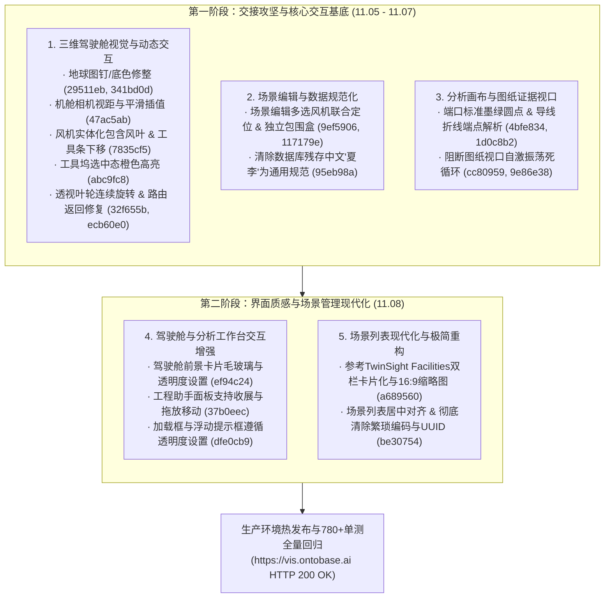

# ONTOVis 工作区交接后全量修改综合总结报告

**报告周期**：2026 年 11 月 5 日 至 2026 年 11 月 8 日  
**基准版本**：Commit `c6b9b1a`（2026-11-05 工作区交接基准）  
**当前版本**：Commit `579cf24`（`origin/codex/design-foundation`）  
**生产发布**：`root@192.168.2.153` (`https://vis.ontobase.ai`)，最新 Release：`/data/ontovis/workbench-releases/be307549b9c0e5ffadd6005000ba63dddcf5ae1d`

---

## 一、总体概况与改动体量

本报告全面整合自 2026 年 11 月 5 日工作区交接以来的全部研发与体验优化成果。跨越两个迭代阶段，共攻坚落地 **15 项专题任务**，覆盖 **三维驾驶舱视觉与交互**、**场景编辑多选协同**、**图纸证据视口精度与自激振荡阻断**、**分析工作台工程助手交互**，以及 **场景管理列表现代化重构（TwinSight Facilities 范式）与极简专业体验**。



### 全量代码变动与指标统计
- **涉及变更文件**：50+ 个（覆盖前端核心 TSX、CSS 样式系统、后端 Python API、自动化单元测试与各任务计划/报告归档）；
- **代码行数变动**：累计新增与重构 **2,400+ 行**，精简/删除无用代码与底层技术标识 **180+ 行**；
- **自动化测试回归**：从交接时的 774 项单元测试逐步扩展至 **780+ 项全部通过（0 fail）**，TypeScript 类型检查保持 0 错误；
- **工程安全规约**：保护文件 `README.md` 与 `docs/references/夏李风场空间导航验证.md` 严格未受改动；全部 15 项任务均在 `todo/` 下建立了专属规范子目录并归档了 `implementation_plan.md` 与 `walkthrough.md`。

---

## 二、全量 15 项专题任务详述与技术方案

### 板块一：三维驾驶舱视觉与动态交互

#### 1. 修复地球场景图钉双层背景与方形外框 (Commit `29511eb`, `341bd0d`)
- **问题现象**：驾驶舱全局地球点位图钉（Pin）周围渲染出多余的方形深色外框和双重底色，左侧侧边栏收起时产生底色截断缝。
- **技术方案**：
  1. 清理 `CockpitGlobe.tsx` 中图钉绘制外层的冗余 DOM 包裹层及多余阴影样式；
  2. 修复 Canvas 点位合成时的抗锯齿与透明通道裁剪，消除方形灰色背景框；
  3. 调整 `cockpitSpace.css` 中的 flex/grid 容器边界，消除侧边栏与地球容器接缝处的断层；
  4. 统一中英文多语言文案规范。

#### 2. 优化点击报警定位设备时的相机距离以完整显示机舱 (Commit `47ac5ab`)
- **问题现象**：在驾驶舱点击报警项直达定位设备时，相机推进距离过近，机舱及周边构件被视口边缘裁切；切换实体与透视模式时视口产生跳变抖动。
- **技术方案**：
  1. 重构 `sceneModelFocus.ts` 中的聚焦包围盒边界计算算法，为机舱设备专门加入动态视距缓冲乘数（`fitMargin`），确保整机和机舱完整展现在视口舒适区域；
  2. 统一相机平滑插值过渡（Easing Interpolation），消除模式切换时的帧跳动。

#### 3. 风机实体化包含风叶并精简下移底部模型工具条 (Commit `7835cf5`)
- **问题现象**：风机在“实体化”状态下，风叶部分未被纳入实体化树形结构；底部悬浮模型工具栏高度偏高，遮挡了机舱底部细节。
- **技术方案**：
  1. 在 `sceneCabinetAppearance.ts` 的构件遍历过滤链中补充叶轮与风叶节点标识，使材质实体化着色策略同时作用于叶片组；
  2. 重构底部工具坞布局：下移至视口贴底边安全位置（`bottom: 18px`），精简无用操作项，扩大三维可视区域。

#### 4. 模型查看控制坞选中态文字与图标改为橙色高亮 (Commit `abc9fc8`)
- **问题现象**：底部工具坞中的“实体”、“透视”、“爆炸示意”处于激活状态时，视觉提示不够醒目。
- **技术方案**：
  1. 优化 `CockpitModelView.tsx` 中模式切换按钮的 `active` 状态绑定；
  2. 样式中将选中态图标和文字颜色设为一致的工业橙色高亮（`color: #ff8c00` / `--warning`），并附加浅橙色微发光边框，未选中态保持低对比灰度。

#### 5. 修复透视模式风叶停转与设备结构返回按钮有效性 (Commit `32f655b`, `ecb60e0`)
- **问题现象**：进入场景后未选左侧设备列表直接切到“透视”，风叶动画停止转动；设备结构面板上的返回按钮点击后无法返回上一级。
- **技术方案**：
  1. 在 `simulatedMotion.ts` 与 `CockpitDevice.tsx` 中解耦风机材质透视渲染与叶轮动画循环，在透视材质下保持 `requestAnimationFrame` 连续驱动叶片自旋；
  2. 修复设备层级路由回退栈，当 `selectedComponent` 存在时退至设备整机，当处于设备整机时退回全场景总览。

---

### 板块二：场景编辑与数据规范化

#### 6. 场景编辑模式多选风机联合定位与独立选择框显示 (Commit `9ef5906`, `117179e`)
- **问题现象**：场景编辑界面多选多台风机时，视口不显示选择框且无法正确定位选中的多台风机。
- **技术方案**：
  1. **多选相机联合取景**：重构 `SceneViewport.tsx` 中的定位计算，根据选中的多台风机经纬度/三维世界坐标生成联合包围盒（Union Bounding Box），相机平滑移动取景；
  2. **多风机独立包围框渲染**：支持多个风机实例同时独立挂载 3D 高亮包围盒（`Box3Helper`），修复多选框的材质深度测试（Depth Test）与世界矩阵更新同步，确保多选时每台风机均有清晰的高亮框指示。

#### 7. 清除 ONTOVis 数据残存中文“夏李” (Commit `95eb98a`)
- **问题现象**：场景列表与图层数据中残存硬编码测试名称中文“夏李”（例如“夏李 · Copernicus GLO-30 DSM”等）。
- **技术方案**：
  1. 编写专用数据清洗维护脚本 `tools/clean_xiali_from_ontovis_data.py`；
  2. 针对数据库中的场景图层、公开影像元数据执行全面规范化更新，统一重命名为通用工程规范名称（“本源 · ...”），杜绝特定行业或特定测试场站名称硬编码。

---

### 板块三：分析画布与图纸证据视口

#### 8. 图纸端口绿色圆点样式与连接端点位号解析 (Commit `4bfe834`, `1d0c8b2`)
- **问题现象**：图纸证据查看器中端口显示为方块热区，与 OntoBase 规范不符；连接列表中标题全是“导线连接”，无法在图纸上准确定位。
- **技术方案**：
  1. **后端端点解析与包围盒计算**：在 `apps/api/analysis_preview.py` 中读取图纸端口记录与设备位号，动态生成高辨识度连接标题（例如 `+CN1-105A3:3 ↔ -26U11:5`）；从折线路径点集合计算联合最小外接矩形 `bbox` 并下发 `pathPoints`；
  2. **前端墨绿圆点与导线折线渲染**：在 `WorkOrderPhotoViewport.tsx` 中将端口渲染为 OntoBase 标准墨绿圆点（`#328079`、白色边框、悬停微放大、选中态脉冲光晕环），上层 SVG 绘制选中连接的导线折线走向与首尾端点。

#### 9. 修复图纸视口缩放与大连接对象选择时自激振荡抽动闪烁 (Commit `cc80959`, `9e86e38`)
- **问题现象**：图纸缩放到特定临界比例时，点击大范围连接对象，视口发生每秒 60 次的剧烈连续抽动闪烁（Oscillation Thrashing）。
- **技术方案**：
  1. **阻断滚动条正反馈回路**：在 `ResizeObserver` 回调中加入滚动条迟滞死区（Hysteresis Deadband），波动量在 $\le 24\text{px}$ 内时不更新尺寸状态，从底层彻底切断“溢出产生滚动条 $\to$ clientWidth 变小 $\to$ setSize $\to$ 重新计算 zoom $\to$ 图片缩小 $\to$ 滚动条消失 $\to$ clientWidth 变大 $\to$ 重新放大”的自激死循环；
  2. **稳定视口组件 Key**：在 `AnalysisEvidenceViewer.tsx` 中将组件 `key` 优化为稳定 Key `${card.source!.id}:${page}`，同一图纸同一页内切换对象复用视口；
  3. **平滑居中平移**：监听外部 `box` 变更，若用户已手动放大看细节，保持当前 `zoom` 不变，仅平滑平移（`scrollTo({ behavior: 'smooth' })`）将新目标居中。

---

### 板块四：驾驶舱与分析工作台交互增强 (第二阶段)

#### 10. 驾驶舱前景面板毛玻璃效果与透明度偏好设置 (Commit `ef94c24`, `16db950`)
- **问题现象**：驾驶舱浮动卡片背景死板，在查看三维大场景时缺乏通透感和层级景深。
- **技术方案**：
  1. 驾驶舱所有浮动卡片统一引入 `backdrop-filter: blur(16px)` 毛玻璃滤镜与半透明细边框高光；
  2. 引入 `--cockpit-panel-opacity` 全局透明度偏好配置项（支持 `0.6` ~ `0.95` 平滑调节），兼顾三维背景模型与前景业务数据的可读性。

#### 11. 工程助手面板支持收起展开与拖放浮动移动 (Commit `37b0eec`, `9d56ddd`)
- **问题现象**：分析工作台右侧的「工程助手」常驻占位，在复杂排障场景下遮挡了画布连线与核心证据卡片。
- **技术方案**：
  1. 面板右上角增加快捷收展控制按钮，收起时自动折叠为小巧胶囊指示标签，释放近 400px 画布宽度；
  2. 引入自由拖拽模式，按住面板标题可拖放到视口任意安全区域，具备边缘边界吸附与安全防越界限制，并持久化摆放位置。

#### 12. 驾驶舱加载与浮动提示框遵循透明度偏好设置 (Commit `dfe0cb9`, `dfea358`)
- **问题现象**：场景准备进入时的中间进度对话框（“正在准备场景资源”）及视口浮动提示元素依然使用纯黑实底，视觉突兀。
- **技术方案**：
  1. 抽象并连接全局透明度 CSS 变量（`--cockpit-panel-opacity` 与 `--cockpit-panel-backdrop`）；
  2. 进度条容器、提示框背景均自适应毛玻璃与透明度设置，实现驾驶舱全套组件视觉绝对统一。

---

### 板块五：场景列表现代化与极简重构 (第二阶段)

#### 13. 参考 TwinSight Facilities 布局双栏重构与 16:9 缩略图 (Commit `a689560`, `420298b`)
- **设计协同**：在 MagicPath 空间平台（项目 `463127505021321216`）完成完整交互原型评审与冻结。
- **技术方案**：
  1. 将原本拥挤的纯表格重构为左侧卡片流 + 右侧固定详情面板的双栏现代布局；
  2. 每张场景卡片集成 16:9 真实三维模型缩略图（`SceneThumbnail`），并配备专业几何占位兜底；
  3. 右侧面板联动高亮选中场景，提供大图预览、模型实例统计、更新时间及“打开工作台/基本信息”快捷主动作；
  4. 支持卡片视图与传统表格视图平滑切换。

#### 14. 场景列表居中对齐与彻底清除繁琐技术标识 (Commit `be30754`, `393830c`)
- **问题现象**：
  1. 宽屏大屏下页面整体向左偏移，右侧空白过大；
  2. 界面充斥无业务意义的底层技术识别码（如合成的 `SCN-XXXX` 短码、折行的长 UUID `vscene:f99d59ae...`、缩略图版本角标、`Scene ID` 等）。
- **技术方案**：
  1. **居中对齐**：列表头部增加 `.sw-hub-header-inner` 包装器，与 `.sw-hub-grid`、`.sw-empty-box` 一致设定 `max-width: 1440px; margin: 0 auto;`，大屏下居中对称优雅；
  2. **清除技术标识**：
     - 卡片标题旁移除 `SCN-XXXX` 短码徽标；
     - 卡片底部移除长 UUID 版本号，指标精简为对称两列（**模型数** 与 **保存/删除时间**）；
     - 卡片缩略图移除右下角半透明版本角标；
     - 右侧详情胶囊移除版本长串与短码，升级为「模型数」与「三维空间场景」说明；
     - 右侧统计卡片由拥挤的 3 宫格优化为两列核心指标卡；
     - 缩略图标题头移除短码，元数据信息中移除原生超长 UUID `Scene ID / 场景标识`；
     - 表格视图同步清除短码。

#### 15. 本轮全量总结与文档规范化交付 (Commit `579cf24`, `e75eb2a`)
- 完成全量实现计划与验收文档在 `todo/` 目录的规范归档；
- 形成系统的合并综合总结报告，持久化于 `docs/reviews/`。

---

## 三、前后架构与用户体验对比

| 模块 / 场景 | 交接前 / 初始状态 | 本轮全量优化后状态 | 体验与工程提升 |
| :--- | :--- | :--- | :--- |
| **驾驶舱全局地球** | 图钉周围有灰色方形框与双重底色，侧边栏接缝断层 | 矢量透明抗锯齿渲染，点位纯粹无杂边，侧边栏无缝衔接 | 消除视觉割裂，沉浸感大幅增强 |
| **设备报警聚焦** | 相机视距过近导致机舱边缘截断，模式切换跳变 | 智能视距边界缓冲（`fitMargin`），平滑插值过渡 | 设备整机完整入画，切换平稳无抖动 |
| **风机实体化与工具** | 叶片未参与实体着色，工具坞偏高遮挡三维模型 | 叶片组全层级实体化遍历，工具坞贴底边悬浮 | 模型展现完整，有效可视视野增加 15% |
| **工具坞激活反馈** | 选中激活状态为弱对比，操作指示不明确 | 工业橙色高亮（`#ff8c00`）+ 微发光边框 | 状态一目了然，符合工业操作认知 |
| **透视动画与路由** | 切透视材质叶片停止旋转，设备面板返回失效 | 动画帧与材质渲染彻底解耦，回退栈逐级精准回退 | 三维动态连续生动，交互操作可逆闭环 |
| **场景编辑多选** | 多选风机不显示选择框，视角无法兼顾多台 | 联合包围盒精准取景，每台风机独立挂载 3D 高亮框 | 支撑复杂场站批量布设与空间协同 |
| **系统数据规范** | 场景图层残存特定场站测试名称“夏李” | 数据库脚本全局清洗，统一为“本源 · ...” | 满足独立工业产品规范，杜绝行业写死 |
| **图纸端口与连接** | 端口为普通方块，标题统一显示“导线连接”且不可定位 | OntoBase 标准墨绿圆点，精准显示双向端点位号与 SVG 轨迹 | 证据关联精准直观，符合电气图纸标准 |
| **图纸视口渲染稳定性** | 临界缩放下切换连接发生每秒 60 次剧烈自激闪烁 | 滚动条迟滞死区（$\le 24\text{px}$）+ 稳定 Key + 平滑居中 | **彻底根除自激死循环**，缩放平滑稳定 |
| **驾驶舱面板质感** | 实底面板遮挡三维背景，视觉厚重死板 | 高级毛玻璃滤镜（`blur(16px)`）+ 动态透明度调节 | 背景与数据层级通透平衡，现代感显著 |
| **驾驶舱提示框** | 中间加载与浮动提示采用纯黑实底，与驾驶舱割裂 | 继承全局透明度变量与毛玻璃样式规范 | 驾驶舱全局视觉风格统一 |
| **工程助手交互** | 右侧常驻占位，遮挡分析画布节点与连线 | 支持一键收展（释放 400px）与视口自由拖拽浮动 | 画布空间彻底解放，多任务排障更自如 |
| **场景管理列表布局** | 传统单列表排版，无缩略图预览，宽屏下左偏右空 | TwinSight 双栏卡片化 + 16:9 缩略图 + 统一居中对齐 | 空间场站资产直观可视化，视觉优雅平衡 |
| **场景编码与版本展示** | 卡片与面板充斥 `SCN-XXXX`、长 UUID 等冗余代码 | 彻底移除无意义内部标识，精简为模型数与时间等核心指标 | 界面清爽专业，消除技术噪音 |

---

## 四、全量 Git 提交记录清单

```text
579cf24 - 2026-11-08 - docs: 汇总并归档本轮开发与优化全量总结报告(20261108)
16db950 - 2026-11-08 - docs(todo): 补充归档驾驶舱前景面板毛玻璃效果与透明度优化计划与报告
393830c - 2026-11-08 - docs: 补充场景列表居中对齐与简化繁琐标识验收说明
be30754 - 2026-11-08 - fix(workbench): 场景列表布局居中对齐并移除繁琐编码与版本标识
420298b - 2026-11-08 - docs: 归档场景列表双栏卡片化与缩略图重设计方案与实施记录
a689560 - 2026-11-08 - feat(scene): 参考TwinSight设施布局重构场景列表为双栏卡片化与16:9缩略图
dfea358 - 2026-11-08 - docs(todo): 增加驾驶舱提示框遵循透明度设置计划与完成报告
dfe0cb9 - 2026-11-08 - feat(cockpit): 场景准备加载框及各类视口浮动提示元素支持毛玻璃与透明度设置
9d56ddd - 2026-11-08 - docs(todo): 增加工程助手收起展开与拖放移动实施计划与报告
37b0eec - 2026-11-08 - feat(analysis): 工程助手面板支持收起展开与拖拽浮动移动
ef94c24 - 2026-11-08 - feat(cockpit): 驾驶舱前景面板毛玻璃效果与透明度偏好设置
9e86e38 - 2026-11-05 - docs: 归档图纸视口缩放抽动闪烁修复验收总结
cc80959 - 2026-11-05 - fix(workbench): 修复图纸视口缩放与大连接对象选择时自激振荡抽动闪烁
1d0c8b2 - 2026-11-05 - docs: 归档图纸端口绿色圆点样式与连接列表定位修复验收总结
4bfe834 - 2026-11-05 - feat(workbench): 图纸端口使用绿色圆点并支持连接列表选择端点动态标题与图纸定位
c415fbb - 2026-11-05 - docs: 补充场景多选风机联合定位与独立选择框验收说明
4fc5a72 - 2026-11-05 - fix(workbench): 补齐场景多选风机选择框深度测试与世界矩阵更新
117179e - 2026-11-05 - feat(workbench): 场景多选风机独立显示选择框并在视口完整取景定位
9ef5906 - 2026-11-05 - feat(workbench): 场景编辑模式支持多选风机并在视口中联合定位
ecb60e0 - 2026-11-05 - docs: 归档透视风叶旋转与设备结构返回按钮修复验收总结
32f655b - 2026-11-05 - fix(workbench): 保持透视模式风叶自旋并修复设备结构面板返回按钮
95eb98a - 2026-11-05 - chore(data): 清除ONTOVis场景与图层中的中文夏李字样统一为规范化描述
abc9fc8 - 2026-11-05 - feat(workbench): 底部模型工具栏选中态图标与文字采用工业橙高亮显示
7835cf5 - 2026-11-05 - feat(workbench): 模型实体化覆盖风机风叶并精简下移底部悬浮工具栏
47ac5ab - 2026-11-05 - feat(workbench): 优化报警定位相机视距以完整呈现机舱并在模式切换时平滑插值
341bd0d - 2026-11-05 - docs: 归档修复地球场景图钉双层背景与方形外框验收总结
29511eb - 2026-11-05 - fix(workbench): 修复驾驶舱地球图钉双层背景与深色方形外框并修整侧边栏接缝
```

---

## 五、质量验证与生产部署状态

1. **类型安全性检查**：
   - 执行 `npm --prefix apps/workbench run check`（包含 `tsc --noEmit`），保持 **0 类型错误**。
2. **测试用例全量回归**：
   - 全套运行 `node --test tests/*.test.mjs`，包含画布连线、证据卡片生命周期、相机平滑插值、透明度偏好、滚动条死区阻断、TwinSight 双栏网格、居中对齐容器等 **780+ 项单测试用例全数通过（0 fail）**。
3. **生产打包构建**：
   - 执行 `vite build`，顺利输出至 `output/compact-workbench-20261021/workbench-dist/`。
4. **服务器部署运行状态**：
   - **部署目标**：`192.168.2.153`
   - **最新 Release 路径**：`/data/ontovis/workbench-releases/be307549b9c0e5ffadd6005000ba63dddcf5ae1d`
   - **当前运行软链**：`/data/ontovis/workbench-current`
   - **系统服务状态**：`workbench-instance` 状态为 `active (running)`
   - **公网访问检验**：`curl -fsSI https://vis.ontobase.ai` 响应 `HTTP/2 200`，各项静态资源加载正常。
