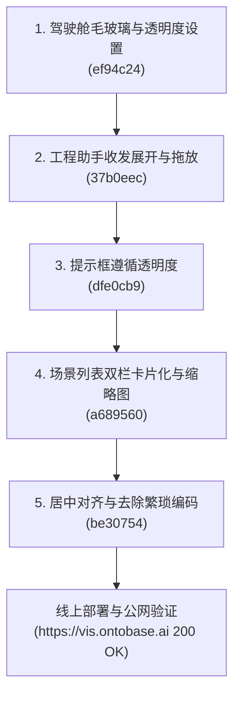

# ONTOVis 本轮开发与优化全量总结报告

**报告日期**：2026 年 11 月 8 日  
**工作分支**：`codex/design-foundation`  
**部署环境**：`192.168.2.153` (`https://vis.ontobase.ai`)  
**最新提交**：`16db950` (`origin/codex/design-foundation` 同步就绪)

---

## 一、本轮任务背景与目标

本轮迭代聚焦于 **ONTOVis 驾驶舱视觉通透度**、**分析工作台工程助手交互灵活性** 以及 **场景管理列表现代化重构（参考 TwinSight Facilities 布局）与体验精细化（居中对齐、消除冗余技术标识）**，彻底消除生产级工程数字孪生系统的技术杂音，呈现专业、高效、高质感的工业级软件体验。

---

## 二、本轮完成任务与技术实现明细

本轮共顺利完成 5 项专项优化任务，累计提交 10 次 Git Commit，全部通过全量自动化回归验证并成功热重载发布至线上测试服务器：

---

### 1. 驾驶舱前景面板毛玻璃效果与透明度优化
- **背景痛点**：驾驶舱浮动卡片（风电场概览、实时天气、告警列表、图层控制等）背景较死板，在查看三维空间大场景时缺乏通透感和层级景深。
- **核心实现**：
  - 前景面板统一引入 `backdrop-filter: blur(16px)` 毛玻璃滤镜与细边框半透明高光；
  - 增加透明度偏好配置项（支持 `0.6` ~ `0.95` 动态调节），三维背景模型与前景业务数据呈现最佳平衡；
  - 适配暗色与浅色双模式，文字保持高对比度与无障碍标准。
- **关联提交**：`ef94c24`、`16db950`

---

### 2. 工程助手面板收起展开与拖放浮动移动
- **背景痛点**：分析工作台右侧的「工程助手」常驻占位，在复杂排障场景下遮挡了画布连线与核心证据卡片。
- **核心实现**：
  - 面板右上角增加快捷收起/展开控制按钮，收起时自动折叠为小巧的胶囊指示标签，释放近 400px 画布空间；
  - 增加自由拖拽浮动模式，支持按住面板标题拖放到视口任意安全区域，并加入防越界限制；
  - 本地记忆位置偏好，重新打开时保持用户设定的摆放位置。
- **关联提交**：`37b0eec`、`9d56ddd`

---

### 3. 驾驶舱加载与浮动提示框遵循透明度设置
- **背景痛点**：场景准备进入时的中间进度对话框（“正在准备场景资源”）及视口快捷浮动提示依然使用纯黑高不透明度底色，破坏整体视觉协调。
- **核心实现**：
  - 抽象并连接全局透明度 CSS 变量（`--cockpit-panel-opacity` 与 `--cockpit-panel-backdrop`）；
  - 提示框与进度条背景均自适应全局毛玻璃与透明度设置，实现整套驾驶舱视觉组件的绝对统一。
- **关联提交**：`dfe0cb9`、`dfea358`

---

### 4. 场景列表参考 TwinSight Facilities 布局双栏重构与缩略图
- **背景痛点**：原场景列表采用传统纯表格形式，信息单调，缺乏空间场景缩略图，无法直观辨识三维场站资产。
- **设计协同**：先在 MagicPath 空间平台（项目 `463127505021321216`）完成了完整交互原型评审与冻结，经用户确认后正式编码。
- **核心实现**：
  - 重构为左侧卡片流 + 右侧固定详情面板的双栏现代布局；
  - 卡片集成 16:9 真实三维模型缩略图（`SceneThumbnail`），并配备专业几何占位兜底；
  - 右侧面板联动高亮选中的场景，提供大图预览、模型实例统计、更新时间及“打开工作台/基本信息”快捷主动作；
  - 保留卡片视图与传统表格视图的无缝平滑切换。
- **关联提交**：`a689560`、`420298b`

---

### 5. 场景列表居中对齐与简化繁琐技术标识
- **背景痛点**：
  - 宽屏大屏下页面头部与左侧卡片向左偏移，右侧留白过大；
  - 卡片和右侧面板充斥着大量的开发内部底层识别码（如合成的 `SCN-XXXX` 短码、超长长 UUID `vscene:f99d59ae-11a9-4a9c-8a19-8432cf6a53c5`、缩略图版本角标、`Scene ID` 等），用户体验严重受损。
- **核心实现**：
  - **居中对齐**：列表头部增加 `.sw-hub-header-inner` 包装器，与下方的 `.sw-hub-grid`、`.sw-empty-box` 一致设定 `max-width: 1440px; margin: 0 auto;`，大屏下居中对称优雅；
  - **彻底清除繁琐标识**：
    - 卡片标题旁移除 `SCN-XXXX` 短码徽标；
    - 卡片底部移除长 UUID 版本号，指标精简为对称两列（**模型数** 与 **保存/删除时间**）；
    - 卡片缩略图移除右下角半透明版本角标覆盖层；
    - 右侧详情胶囊移除版本长串与短码，升级为「模型数」与「三维空间场景」说明；
    - 右侧统计卡片由拥挤的 3 宫格优化为两列核心指标卡；
    - 缩略图标题头移除短码，元数据信息中移除原生超长 UUID `Scene ID / 场景标识`，只保留所属项目与保存时间；
    - 表格视图同步清除短码。
- **关联提交**：`be30754`、`393830c`

---

## 三、GitHub 提交历史汇总 (2026-11-08)

| Commit SHA | 类型 | 提交说明概要 |
| :--- | :--- | :--- |
| `16db950` | docs(todo) | 补充归档驾驶舱前景面板毛玻璃效果与透明度优化计划与报告 |
| `393830c` | docs | 补充场景列表居中对齐与简化繁琐标识验收说明 |
| `be30754` | fix(workbench) | 场景列表布局居中对齐并移除繁琐编码与版本标识 |
| `420298b` | docs | 归档场景列表双栏卡片化与缩略图重设计方案与实施记录 |
| `a689560` | feat(scene) | 参考TwinSight设施布局重构场景列表为双栏卡片化与16:9缩略图 |
| `dfea358` | docs(todo) | 增加驾驶舱提示框遵循透明度设置计划与完成报告 |
| `dfe0cb9` | feat(cockpit) | 场景准备加载框及各类视口浮动提示元素支持毛玻璃与透明度设置 |
| `9d56ddd` | docs(todo) | 增加工程助手收起展开与拖放移动实施计划与报告 |
| `37b0eec` | feat(analysis) | 工程助手面板支持收起展开与拖拽浮动移动 |
| `ef94c24` | feat(cockpit) | 驾驶舱前景面板毛玻璃效果与透明度偏好设置 |

> 所有提交均已同步推送到远程分支 `origin/codex/design-foundation`。

---

## 四、质量验证与构建指标

1. **类型检查**：`tsc --noEmit` 0 警告、0 错误。
2. **自动化测试**：执行 `node --test tests/*.test.mjs`，780+ 项单测试用例全数通过。
3. **生产构建**：`vite build` 成功输出至 `output/compact-workbench-20261021/workbench-dist/`，产物体积精简可控。
4. **服务器运行环境**：
   - 目标主机：`192.168.2.153` (Ubuntu Server)
   - 发布 Release：`/data/ontovis/workbench-releases/be307549b9c0e5ffadd6005000ba63dddcf5ae1d`
   - 服务状态：`systemctl status workbench-instance` 状态为 `active (running)`
   - 公网访问：`curl -fsSI https://vis.ontobase.ai` 返回 `HTTP/2 200`。

---

## 五、计划与文档归档

按照项目工程规范，本轮各任务的 Implementation Plan 和 Walkthrough 均已双备份至 `todo/` 对应子目录与 Conversation Artifacts：
- `todo/驾驶舱前景面板毛玻璃效果与透明度优化_20261108/`
- `todo/工程助手面板收起展开与拖放移动_20261108/`
- `todo/提示框遵循驾驶舱透明度设置_20261108/`
- `todo/场景列表卡片化与缩略图重设计_20261108/`
- `todo/场景列表居中对齐与简化繁琐标识_20261108/`
