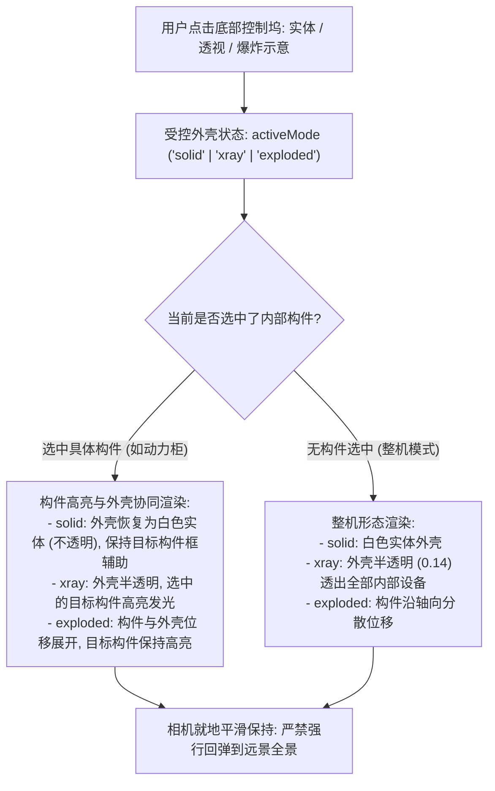

# 排查与修复三维视口实体透视操作逻辑与切换抖动 实施方案

## 1. 问题背景与现象梳理

### 1.1 用户问题与现象
1. **问题一（操作逻辑认知偏差）**：
   - 用户原先以为底部的“实体 / 透视”按钮是专门用来控制风机外壳**“实体化、透明化”**的视觉开关。
   - 但在实际操作中，发现它的行为与左侧选中的对象密切相关（选中构件时外壳自动变透明，点击“实体”外壳没有变实体；或者点击透视后选中的构件高亮又被清空了）。
2. **问题二（切换风机后的来回切换与跳动异常）**：
   - 用户上传了现场操作录屏 `1105_(1).mp4`。
   - 录屏显示：在风机视图中，点击底部的“实体”、“透视”按钮时，模型与相机出现**剧烈拉远又拉近、外壳在实体与透视之间来回弹跳反弹**的异常状态不稳定现象。

---

## 2. 深度根因排查与逻辑解析

经过对视频关键帧逐帧拆解（见下分析）以及对前端渲染引擎源码的追踪，深层根因如下：

### 2.1 根因一：两套渲染机制混淆且缺乏协同
系统中原本存在两套独立设计的三维显示机制：
| 机制名称 | 驱动源 | 原始设计目标 | 实际视觉表现 |
|---|---|---|---|
| **机制 A：构件高亮与外壳透明** (`SceneCabinetAppearance`) | 点击设备结构树构件（如动力柜、发电机）或点击报警定位 | 突出选中的内部构件 | **强制**将外围的机舱外壳与塔筒设为半透明（opacity: 0.2~0.32），高亮选中部件 |
| **机制 B：整机形态查看** (`SceneModelView` / 底部实体·透视·爆炸按钮) | 点击屏幕底部的“实体 / 透视 / 爆炸示意”按钮 | 整机宏观形态演示 | `实体`：外壳完全不透明<br>`透视`：外壳半透明 (opacity: 0.14)<br>`爆炸示意`：机舱、叶轮与部件沿轴向分散位移 |

**为什么用户觉得与预期不符？**
- 当用户进入具体构件（如动力柜）时，**机制 A** 已经把外壳自动变透明了。
- 此时屏幕底部的“实体 / 透视”控制坞依然显示，且按钮选中的是“实体”。
- 用户看到外壳透明，以为底部的“实体”按钮可以把外壳关回实体，于是点击“实体”；
- 但由于左侧树依然选中着构件，**机制 A 仍然在强制把外壳设为透明**，导致用户的点击“完全无效”！
- 用户若点击“透视”，**机制 B** 启动，却在代码第 117 行硬编码将 `componentFocus` 清空为 `undefined`，导致构件高亮被打断；
- 用户再次点“实体”，`componentFocus` 又重新复活，外壳又被机制 A 变透明。用户感觉**“实体与透视完全受制于当前选中对象，而且来回打架”**。

### 2.2 根因二：相机视角的“强制回弹”震荡（视频中剧烈跳动的罪魁祸首）
在 `apps/workbench/src/SceneViewport.tsx` 第 266~276 行中：
```ts
const clearModelView = (restore = false) => {
  inspection?.driver.dispose();
  inspection = null;
  // 退出透视时，强行将相机动画飞回进入透视前保存的视角（往往是几百米外的整机远景）
  if (restore && inspectionView) {
    const saved = inspectionView;
    inspectionView = null;
    if (current.current.selectedId === saved.instanceId) moveView(saved.view);
  }
};
```
- 当用户点击“透视”时，系统记录了当时的远景视角 `saved.view`，并将相机推到机舱近景；
- 当用户点击“实体”时，系统调用 `clearModelView(true)`，**强行动画把相机飞回远景全景**！
- 此时设备树或构件的聚焦机制又被触发，又发起一次动画把相机**飞回机舱特写**！
- **这直接导致用户在视频中看到的 5.5s ~ 7.9s 相机在远景和近景之间来回疯狂拉扯！**

### 2.3 根因三：`CockpitModelView` 为非受控组件，内外状态脱节
在 `apps/workbench/src/CockpitModelView.tsx` 中：
- 组件内部使用孤立的 `const [mode, setMode] = useState<'solid'|'xray'|'exploded'>('solid')`；
- 外部父组件传入的各种重置信号或风机切换无法同步到内部 `mode`；
- 卸载时组件还执行了 `useEffect(() => () => onChange(null), [onChange])`，在组件挂载卸载时不断产生异步竞态与反复清空，导致按钮显示状态与模型真实形态完全脱钩。

---

## 3. 改进设计方案

为了让“实体 / 透视”真正符合用户的直觉心智模型（**“外壳是实体还是透明的统一全局开关”**），我们进行如下统一重构：



### 3.1 核心改进要点
1. **外壳模式受控化（Unify Shell Mode）**：
   - 底部的“实体 / 透视 / 爆炸示意”按钮由父级受控，状态提升为单一数据源；
   - 切换不同风机时，默认重置为 `'solid'`（实体模式），按钮与视觉 100% 同步。
2. **构件查看与外壳透明度解耦**：
   - 改造 `SceneCabinetAppearance`：允许在选中构件的同时，尊重外壳模式 `shellMode`；
   - 当用户选中构件但点击了“实体”：外壳恢复实体不透明，不破坏构件的选中状态；
   - 当用户点击“透视”：外壳变为半透明，内部构件高亮透视可见；
   - 当用户点击“爆炸示意”：构件位移展开，选中构件依然保持高亮；
   - 不再发生“点击实体外壳不响应”或“点击透视清除构件高亮”的互斥打架问题！
3. **消除相机的恶意回弹与拉扯**：
   - 移除 `clearModelView` 中粗暴的 `moveView(saved.view)` 相机回弹逻辑；
   - 切换实体与透视纯粹是模型材质的平滑过渡，相机保持在用户当前观察的视点，杜绝任何镜头抽搐！

---

## 4. 涉及文件清单

| 文件路径 | 变更目的 |
|---|---|
| [`apps/workbench/src/CockpitModelView.tsx`](file:///Users/diwei/项目2026/OntoVis/apps/workbench/src/CockpitModelView.tsx) | 将组件改为受控模式，接收 `mode` prop，移除卸载时强制清空的竞态 hook |
| [`apps/workbench/src/ProjectCockpit.tsx`](file:///Users/diwei/项目2026/OntoVis/apps/workbench/src/ProjectCockpit.tsx) | 维护统一受控的 `modelMode` 状态，解除 `componentFocus` 与 `modelViewRequest` 的互斥打架 |
| [`apps/workbench/src/SceneViewport.tsx`](file:///Users/diwei/项目2026/OntoVis/apps/workbench/src/SceneViewport.tsx) | 移除 `syncModelView` 中因构件聚焦而销毁外壳模式的逻辑，移除退出透视时强制把镜头甩回远景全景的 `moveView(saved.view)` 逻辑 |
| [`apps/workbench/src/sceneCabinetAppearance.ts`](file:///Users/diwei/项目2026/OntoVis/apps/workbench/src/sceneCabinetAppearance.ts) | 支持受控外壳透明模式，当用户要求实体时，外壳保持实体不透明 |
| [`apps/workbench/tests/cockpit-model-view.test.mjs`](file:///Users/diwei/项目2026/OntoVis/apps/workbench/tests/cockpit-model-view.test.mjs) | 补充受控模式、状态切换与构件协同的单元测试，确保逻辑零回退 |

---

## 5. 验证计划

1. **自动化测试**：
   - 运行模型查看与构件外观测试用例：
     ```bash
     node --experimental-strip-types --test apps/workbench/tests/cockpit-model-view.test.mjs apps/workbench/tests/scene-cabinet-appearance.test.mjs apps/workbench/tests/scene-component-focus.test.mjs
     ```
   - 运行驾驶舱全量测试：
     ```bash
     node --experimental-strip-types --test apps/workbench/tests/cockpit-simulation.test.mjs apps/workbench/tests/cockpit-space.test.mjs
     ```
2. **TypeScript 静态检查与打包构建**：
   ```bash
   node apps/workbench/node_modules/typescript/bin/tsc --noEmit -p apps/workbench
   ONTOVIS_LOGIN_MEDIA_PUBLIC_DIR=/Users/diwei/项目2026/OntoVis/output/scene-info-save-20261105/_work/media-public npm --prefix apps/workbench run build
   ```
3. **交互验证（对照用户视频）**：
   - 在设备视图中，从整机切换到内部部件（如动力柜），确认点击“实体”外壳变为白色实体，点击“透视”外壳平滑半透明；
   - 切换到其他风机后，点击“实体”、“透视”、“爆炸示意”，确认相机不再发生拉远拉近剧烈晃动，状态平稳顺畅。
